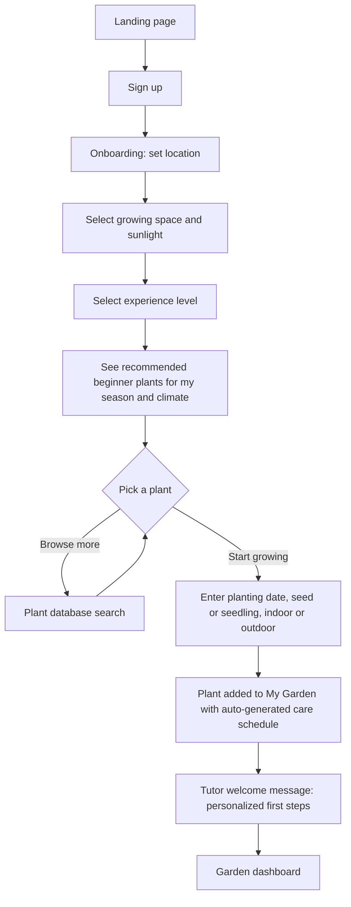
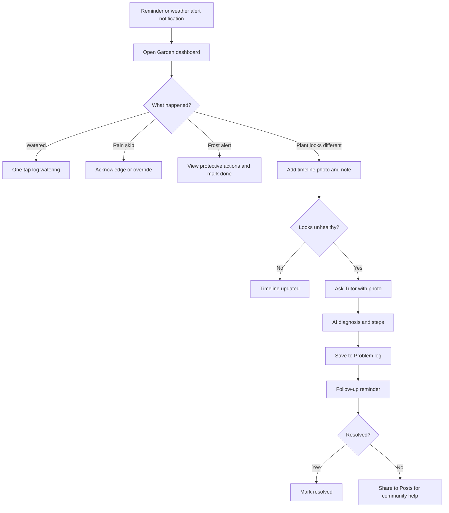
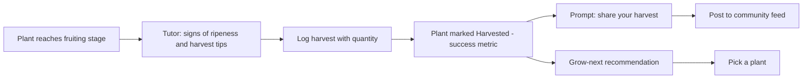
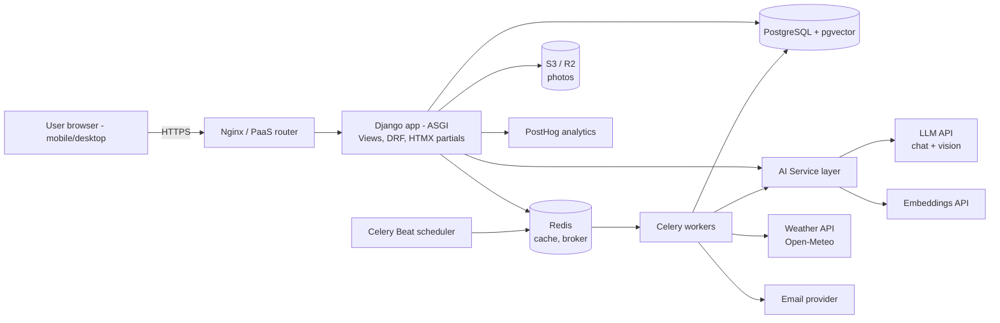
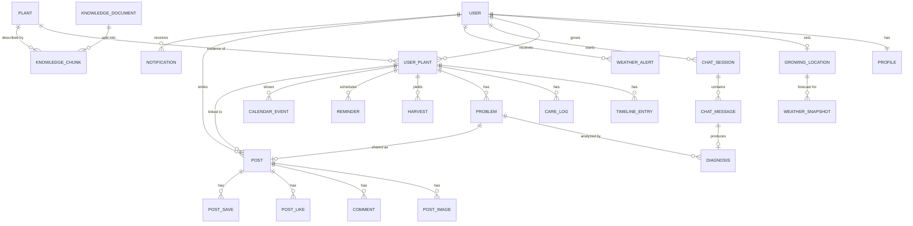

# Greenhand — Product Requirements Document (PRD)

**Product:** Greenhand — *Making Farming Accessible to Everyone*
**Team:** Greenhand (Team 4)
**Document owner:** Product
**Status:** Draft v1.0
**Last updated:** October 13, 2026
**Primary technology:** Django (Python)

---

## Table of Contents

1. [Overview](#1-overview)
2. [Requirements](#2-requirements)
3. [Core Features](#3-core-features)
4. [User Flow](#4-user-flow)
5. [MVP Scope (In-Scope vs. Out-of-Scope)](#5-mvp-scope-in-scope-vs-out-of-scope)
6. [Technology Stack & Core Architecture](#6-technology-stack--core-architecture)
7. [Database Schema](#7-database-schema)
8. [Appendix: Open Questions & Risks](#8-appendix-open-questions--risks)

---

## 1. Overview

### 1.1 Product Summary

Greenhand is a web application that acts as a **personal AI tutor for urban and backyard farming**. It teaches beginners how to grow their own food from seed to harvest by combining:

- an **AI Gardening Tutor** that knows each user's plants, planting dates, location, recent logs, and local weather;
- a **"My Garden" workspace** for tracking each plant's lifecycle, problems, and care calendar;
- an **AI-curated plant database** with "what to grow next" recommendations;
- a **community feed (Posts)** where growers share outcomes and troubleshoot together.

### 1.2 Why (Vision & Rationale)

- **Food security at household level.** Climate change and population growth (approaching ~10 billion by 2050) put sustained pressure on the food supply. If each household can grow part of its own food, it becomes more resilient.
- **A durable life skill.** Growing food in a backyard, balcony, or windowsill is a skill that becomes more valuable if food becomes scarce or expensive.
- **Reduce sole dependence on farmers and supply chains** for basic produce such as herbs, leafy greens, and vegetables.
- **The real barrier is guidance, not interest.** Most beginners quit because generic advice doesn't match *their* plant, *their* climate, and *their* problem. Conversational AI grounded in the user's own garden data closes that gap.

### 1.3 Problem Statement

> First-time growers want to grow their own food but don't know **what** to plant, **how** to plant it in their specific space and climate, or **what to do** when something goes wrong. Existing resources are generic, scattered, and not personalized, so beginners lose plants, lose confidence, and give up before their first harvest.

### 1.4 Target Users

| Persona | Description | Primary need |
|---|---|---|
| **Curious Beginner** ("Maya, 27, renter") | Interested in urban farming, has a balcony or windowsill, has never grown food. | Know what can realistically grow in her space and get step-by-step help. |
| **Self-Sufficiency Learner** ("David, 41, homeowner") | Wants to grow a meaningful share of his household's vegetables in his backyard. | Plan crops by season and climate, avoid losses, reach harvest reliably. |
| **Returning Hobbyist** ("Linda, 58") | Has tried before but lost plants to pests, watering mistakes, or frost. | Diagnose problems quickly and get timely weather-aware reminders. |

**Who it is not for (initially):** commercial farmers, large-scale agriculture, hydroponics/vertical-farm operators.

### 1.5 Goals & Success Metrics

| Goal | Metric | MVP target (first 6 months post-launch) |
|---|---|---|
| **North Star — users actually grow food** | **# of plants successfully grown to harvest** (UserPlant reaches `harvested` status with ≥1 harvest log) | 500 harvested plants; ≥ 25% of plants started reach harvest |
| **Retention** | % of users still active (≥1 meaningful action/week) at **Day 30, Day 60, Day 90** | D30 ≥ 35%, D90 ≥ 20% |
| Activation | % of new users who add their first plant within 24h of signup | ≥ 60% |
| Tutor value | % of tutor answers rated helpful (👍) | ≥ 80% |
| Diagnosis value | % of logged problems marked "resolved" | ≥ 50% |
| Weather usefulness | % of weather-adjusted reminders (skipped watering / frost alert) acknowledged | ≥ 40% |
| Community | % of weekly actives who post, comment, or react | ≥ 20% |

**Definitions**
- *Meaningful action:* logging a care event, uploading a photo, asking the tutor, or posting/commenting.
- *Successful harvest:* user marks plant as harvested and logs at least one harvest entry (quantity optional).

---

## 2. Requirements

### 2.1 Functional Requirements

Priority: **P0** = must have for MVP, **P1** = should have for MVP if time allows, **P2** = post-MVP.

#### Accounts & Profile
| ID | Requirement | Priority |
|---|---|---|
| FR-01 | Users can sign up / log in with email + password; optional Google OAuth. | P0 |
| FR-02 | Users can set up a profile: username, profile picture, bio, pronouns, birthday (optional). | P0 |
| FR-03 | Users must set a **growing location** (city/ZIP or geolocation → lat/long) used for weather and climate. | P0 |
| FR-04 | Users can set growing context: space type (backyard, balcony, windowsill, indoor), sunlight level, experience level. | P0 |
| FR-05 | Profile displays the user's own, liked, and saved posts. | P1 |

#### Pick a Plant (Plant Database)
| ID | Requirement | Priority |
|---|---|---|
| FR-10 | Users can browse and search a plant database by name, category (herb, vegetable, fruit), difficulty, and season. | P0 |
| FR-11 | Each plant page shows care info: sunlight, watering frequency, spacing, days to germination, days to harvest, hardiness/frost tolerance, container suitability. | P0 |
| FR-12 | The app indicates whether a plant is **suitable for the user's location and current season**. | P0 |
| FR-13 | "Start growing" adds the plant to My Garden with planting date, method (seed/seedling), and location in garden. | P0 |
| FR-14 | AI summary of common problems and solutions for each plant, drawn from community Posts and My Garden problem logs. | P1 |
| FR-15 | AI "grow next" recommendations based on user history, season, and local climate. | P1 |
| FR-16 | Usage guidance per plant (recipes, companion planting, preservation). | P2 |

#### My Garden
| ID | Requirement | Priority |
|---|---|---|
| FR-20 | Users see a list of all their plants with status (planned, sprouting, growing, flowering, fruiting, harvested, failed). | P0 |
| FR-21 | **Lifecycle timeline:** users add photo + note entries tagged with a growth stage. | P0 |
| FR-22 | **Care logging:** users log watering, fertilizing, pruning, pest treatment, harvest. | P0 |
| FR-23 | **Visual calendar:** icon-based events (watering, germination, fruiting, harvest) per plant and garden-wide. | P0 |
| FR-24 | **Reminders:** recurring watering reminders based on plant care schedule (in-app + email). | P0 |
| FR-25 | **Problem log:** users log an issue (text + photo); AI suggests causes and fixes; user can mark resolved. | P0 |
| FR-26 | Problems and progress can be shared to Posts in one action. | P1 |
| FR-27 | Harvest logging with quantity/unit (e.g., 300 g, 12 tomatoes). | P0 |

#### AI Gardening Tutor
| ID | Requirement | Priority |
|---|---|---|
| FR-30 | Chat interface where users ask gardening questions in natural language. | P0 |
| FR-31 | Tutor is **context-aware**: it automatically knows the user's plants, planting dates, growth stages, location, recent logs (last ~14 days), and current/forecast weather. | P0 |
| FR-32 | Users can scope a conversation to a specific plant ("Ask about this plant" from a plant page). | P0 |
| FR-33 | **Photo upload for diagnosis:** user uploads a photo; tutor returns likely issues, confidence, and next steps. | P0 |
| FR-34 | Answers are grounded via RAG on a curated knowledge base (plant care guides) and cite sources where possible. | P0 |
| FR-35 | Tutor can suggest actions (e.g., "Create a reminder to check for aphids in 3 days") that the user confirms with one click. | P1 |
| FR-36 | Users rate answers (👍/👎) for quality monitoring. | P0 |
| FR-37 | Tutor proactively offers "this week in your garden" guidance on the dashboard. | P1 |

#### Weather Integration
| ID | Requirement | Priority |
|---|---|---|
| FR-40 | Fetch current conditions and 7-day forecast for the user's location. | P0 |
| FR-41 | **Skip watering after rain:** if rainfall ≥ threshold (default 5 mm in last 24h, or ≥ 70% chance in next 12h), outdoor plants' watering reminders are auto-skipped and the user is notified. Indoor plants are unaffected. | P0 |
| FR-42 | **Frost alerts:** if forecast min temperature ≤ plant's frost threshold (default 2 °C / 36 °F) within 48h, alert users with frost-sensitive outdoor plants, with protective actions. | P0 |
| FR-43 | Heat-wave alerts (≥ 32 °C / 90 °F) suggesting extra watering/shade. | P1 |
| FR-44 | Weather summary shown on dashboard and passed to the tutor as context. | P0 |

#### Posts (Community)
| ID | Requirement | Priority |
|---|---|---|
| FR-50 | Users create posts with text and up to 4 images, optionally linked to a plant in their garden. | P0 |
| FR-51 | Post types: **Progress**, **Harvest**, **Question/Problem**, **Tip**. | P0 |
| FR-52 | Users can comment, like, and save posts. | P0 |
| FR-53 | Feed with "Latest" and "Same plants as me" filters. | P0 |
| FR-54 | AI suggestion auto-attached to Question/Problem posts (clearly labeled as AI). | P1 |
| FR-55 | Repost / share. | P2 |
| FR-56 | Report post/comment; admin moderation queue. | P0 |

### 2.2 Non-Functional Requirements

| Category | Requirement |
|---|---|
| **Performance** | Page loads < 2 s (p95) on broadband; tutor first token < 3 s; full photo diagnosis < 15 s. |
| **Availability** | 99.5% uptime for MVP. Graceful degradation if AI or weather APIs fail (show cached data / friendly error). |
| **Scalability** | Support 10,000 registered users and 1,000 concurrent sessions at MVP without re-architecture. |
| **Security** | Django auth with hashed passwords; HTTPS everywhere; CSRF protection; per-user object permissions (users can only edit their own garden); rate-limit AI endpoints (e.g., 50 tutor messages/user/day). |
| **Privacy** | Store location only at city/ZIP precision by default; strip EXIF GPS from uploaded photos; allow account and data deletion. |
| **AI safety & quality** | Tutor stays on gardening/food-growing topics; clearly flags uncertainty; never gives advice on toxic plant consumption without warnings; all AI content labeled. |
| **Accessibility** | WCAG 2.1 AA: alt text for images, keyboard navigation, sufficient color contrast. |
| **Responsiveness** | Mobile-first responsive web (most photos are taken in the garden on a phone). |
| **Usability** | A first-time user can add their first plant in < 3 minutes. Plain-language, jargon-free copy. |
| **Maintainability** | ≥ 70% test coverage on core apps; CI runs tests and linting on every PR. |

---

## 3. Core Features

### 3.1 Profile & Onboarding
**Purpose:** Capture enough context for personalization from minute one.

- Onboarding wizard (4 steps): *Location → Growing space (backyard / balcony / windowsill / indoor) → Sunlight → Experience level*.
- Ends with "Pick your first plant" recommendations filtered by location, season, and space.
- Profile page: avatar, username, bio, pronouns, stats ("3 plants growing · 2 harvests"), and tabs for own/liked/saved posts.

### 3.2 Pick a Plant (AI-Curated Plant Database)
**Purpose:** Help beginners choose plants they can actually succeed with.

- Search and filter by category, difficulty ("Beginner-friendly"), season, container-friendly.
- Each plant card shows a **suitability badge** for the user: ✅ *Great for you now*, ⚠️ *Possible with care*, ❌ *Not recommended now* (computed from hardiness zone/climate, current month, and space type).
- Plant detail page: care requirements, timeline (germination → harvest), common problems (AI-summarized from community data, P1), and **Start Growing** button.
- Seed data sourced from Perenual API + team-curated guides for ~50 beginner food plants (herbs, leafy greens, tomatoes, peppers, beans, etc.).

### 3.3 My Garden
**Purpose:** A personal record and control center for every plant.

- **Garden dashboard:** cards for each plant showing stage, days since planting, next care task, and weather badges (🌧 watering skipped, ❄️ frost risk).
- **Plant detail tabs:**
  - *Timeline* — photo + note entries by growth stage (seedling → vegetative → flowering → fruiting → harvest).
  - *Care log* — watering, fertilizing, pruning, treatments, harvests.
  - *Problems* — open/resolved issues with AI suggestions and photos.
  - *Calendar* — icon-based month view of all events and upcoming reminders.
- **Harvest logging** marks success and feeds the North Star metric.

### 3.4 AI Gardening Tutor
**Purpose:** Personalized, grounded, step-by-step guidance — the heart of the product.

**Context injected into every conversation:**
```
User profile:   location (city, climate zone), space type, sunlight, experience level
Garden:         each plant → species, variety, planting date, days since planting, current stage, indoor/outdoor
Recent logs:    last 14 days of care events, timeline notes, open problems
Weather:        current conditions, last-24h rainfall, 7-day forecast, active alerts
Knowledge:      top-k retrieved chunks from curated plant-care knowledge base (RAG)
```

**Capabilities:**
- General Q&A ("When should I transplant my tomato seedlings?") answered for *this* user's climate and planting date.
- **Photo diagnosis:** upload a leaf/plant photo → structured result: *likely issue(s), confidence (low/med/high), why, what to do now, what to watch for*. Can be saved straight into the plant's Problem log.
- **Suggested actions:** "Add reminder", "Log this problem", "Share to Posts" buttons attached to answers (P1).
- **Guardrails:** off-topic refusal, uncertainty flagging, "consult a local extension office" fallback for serious issues, labeled as AI.

### 3.5 Weather-Aware Care
**Purpose:** Turn generic schedules into smart, local ones.

- Background job polls forecasts for each distinct user location (grouped by rounded lat/long to minimize API calls) every 3 hours.
- **Rule engine:**
  - Rain rule → auto-skip outdoor watering reminders; notify "Rain did the watering today 🌧".
  - Frost rule → alert for frost-sensitive outdoor plants with actions (cover, move indoors, water soil before frost).
  - Heat rule (P1) → suggest extra watering and shade.
- Users can override any skipped reminder.

### 3.6 Posts (Community)
**Purpose:** Share outcomes of tutoring, learn from peers, and build a practical knowledge base.

- Post composer pre-fills from My Garden ("Share this harvest", "Ask the community about this problem").
- Feed filters: Latest, Same plants as me.
- Interactions: comment, like, save; report for moderation.
- AI suggestion on Problem posts (P1), labeled clearly.
- Community data (anonymized, aggregated) feeds the plant database's "common problems" summaries.

### 3.7 Notifications
- In-app notification center + email (P0); web push (P1).
- Types: care reminders, weather alerts, comments/likes on posts, weekly garden digest.

---

## 4. User Flow

### 4.1 Onboarding & First Plant (Activation Flow)



### 4.2 Daily Care Loop (Retention Flow)



### 4.3 Harvest & Share (Success Flow)



### 4.4 Key Screens

| Screen | Primary actions |
|---|---|
| Garden dashboard (home) | View plants, today's tasks, weather badges, tutor tip of the week |
| Plant database | Search, filter, view suitability, Start Growing |
| Plant detail (in My Garden) | Timeline, care log, problems, calendar, Ask Tutor |
| Tutor chat | Ask questions, upload photo, scope to a plant, rate answers |
| Calendar | Month view with icons; upcoming reminders |
| Posts feed | Browse, filter, create post, interact |
| Profile | Edit info, location & growing context, view own/saved posts |
| Notifications | Reminders, alerts, social activity |

Navigation: persistent bottom bar on mobile / top bar on desktop — **Garden · Plants · Tutor · Posts · Profile**.

---

## 5. MVP Scope (In-Scope vs. Out-of-Scope)

**MVP objective:** Prove that a context-aware AI tutor + weather-aware care tracking helps beginners get a plant to harvest and keeps them coming back.

### 5.1 In-Scope (MVP)

| Area | Included |
|---|---|
| Accounts | Email/password auth, Google OAuth, profile, onboarding wizard, location & growing context |
| Plant database | ~50 curated beginner food plants (seeded from Perenual + team curation), search/filter, suitability badge, Start Growing |
| My Garden | Plant list & status, lifecycle timeline with photos, care log, problem log, harvest log, visual calendar |
| Reminders | Recurring watering reminders (in-app + email) |
| AI Tutor | Context-aware chat (profile + garden + logs + weather), RAG over curated knowledge base, photo diagnosis, answer rating |
| Weather | Current + 7-day forecast, rain-skip watering rule, frost alerts |
| Posts | Create post (text + images, linked plant, type), feed (Latest / Same plants), comment, like, save, report |
| Admin | Django admin for plant data, knowledge base, moderation queue |
| Analytics | Event tracking for North Star (harvests) and retention (D30/D60/D90) |
| Platform | Responsive web (mobile-first), English only |

### 5.2 Out-of-Scope (Post-MVP / Future)

| Feature | Reason deferred |
|---|---|
| Native iOS/Android apps | Responsive web validates demand first |
| AI "grow next" recommendations (FR-15) | Needs harvest history data; candidate for v1.1 |
| AI-summarized common problems from community data (FR-14) | Needs sufficient community volume |
| Reposts, follows, DMs | Not essential to learning outcome |
| Music-for-plants feature | Playful engagement idea; low priority vs. core learning |
| IoT sensor integration (soil moisture, etc.) | Hardware complexity |
| Garden layout planner / bed designer | Large scope; separate initiative |
| Marketplace / seed-swap / produce sharing | Trust & safety and logistics complexity |
| Multi-language support | English-first launch |
| Web push & SMS notifications | Email + in-app sufficient for MVP |
| Pest/disease identification fine-tuned model | Use general vision LLM first; evaluate later |
| Gamification (badges, streaks, levels) | Evaluate after retention baseline |
| Recipes / usage guidance (FR-16) | Nice-to-have |

---

## 6. Technology Stack & Core Architecture

### 6.1 Technology Stack

| Layer | Technology | Rationale |
|---|---|---|
| **Backend framework** | **Django 5.x** (Python 3.12) | Main technology; batteries-included auth, ORM, admin, forms |
| **API layer** | Django REST Framework (DRF) | JSON endpoints for chat, uploads, calendar, and future mobile apps |
| **Frontend** | Django Templates + **HTMX** + **Alpine.js** + **Tailwind CSS** | Fast to build within Django; interactive without a separate SPA. Chart/calendar via FullCalendar.js |
| **Real-time chat streaming** | Django Channels (ASGI) *or* Server-Sent Events via `StreamingHttpResponse` | Stream tutor tokens to the UI |
| **Database** | **PostgreSQL 16** | Relational data, JSONB, full-text search |
| **Vector search (RAG)** | **pgvector** extension in PostgreSQL | Keeps embeddings in the same DB; no extra vector service |
| **Background jobs** | **Celery** + **Redis** (broker) + **Celery Beat** | Weather polling, reminders, emails, embedding jobs |
| **Cache** | Redis | Weather cache, rate limiting, sessions |
| **LLM** | Hosted LLM API with vision support (e.g., Anthropic Claude or OpenAI) behind an internal `ai_service` interface | Chat, photo diagnosis, summaries; provider-swappable |
| **Embeddings** | Hosted embedding model (e.g., OpenAI `text-embedding-3-small` or Voyage) | Knowledge base vectors |
| **Plant data** | Perenual API (seed import) + curated guides | Plant care information |
| **Weather data** | **Open-Meteo API** (free, no key) — OpenWeatherMap as fallback | Forecast, rainfall, min temps |
| **Geocoding** | Open-Meteo Geocoding / Nominatim | City/ZIP → lat/long |
| **Media storage** | S3-compatible storage (AWS S3 / Cloudflare R2) via `django-storages`; Pillow for resizing & EXIF stripping | Plant and post photos |
| **Auth** | `django-allauth` | Email + Google OAuth |
| **Email** | SendGrid / Amazon SES via `django-anymail` | Reminders, alerts, digests |
| **Analytics** | PostHog (self-hosted or cloud) | Funnels, retention cohorts |
| **Monitoring** | Sentry (errors), structured logging | Reliability |
| **Testing & CI** | pytest-django, factory_boy, GitHub Actions, Ruff | Quality gates |
| **Deployment** | Docker + docker-compose (dev); Render / Railway / Fly.io (prod) with managed Postgres & Redis | Simple PaaS for a student/startup team |

### 6.2 Django Project Structure

```
greenhand/
├── config/                 # settings (base/dev/prod), urls, asgi, wsgi, celery
├── apps/
│   ├── accounts/           # custom User, Profile, GrowingLocation, onboarding
│   ├── plants/             # Plant catalog, care guides, suitability logic
│   ├── garden/             # UserPlant, TimelineEntry, CareLog, Problem, Harvest
│   ├── calendar_app/       # CalendarEvent, Reminder, scheduling logic
│   ├── tutor/              # ChatSession, ChatMessage, context builder, RAG, diagnosis
│   ├── knowledge/          # KnowledgeDocument, KnowledgeChunk (pgvector), ingestion
│   ├── weather/            # WeatherSnapshot, WeatherAlert, rule engine, API clients
│   ├── community/          # Post, PostImage, Comment, Like, Save, Report
│   ├── notifications/      # Notification model, email/in-app delivery
│   └── core/               # shared utils, base models, permissions, ai_service
├── templates/
├── static/
└── tests/
```

### 6.3 Core Architecture



### 6.4 Key Technical Flows

**A. Context-aware tutor message**
1. User sends message (optionally with photo and/or plant scope) → `POST /api/tutor/sessions/{id}/messages/`.
2. `ContextBuilder` assembles: profile, location & climate zone, user's plants (stage, days since planting), last 14 days of logs, open problems, cached weather + alerts.
3. `Retriever` embeds the question → top-k (k=5) chunks from `KnowledgeChunk` via pgvector cosine similarity, filtered by plant when scoped.
4. Prompt = system instructions (persona, guardrails, output format) + context + retrieved chunks + conversation history (last N turns) + user message (+ image).
5. LLM response streamed to the browser via SSE; saved to `ChatMessage` with token counts, retrieved chunk IDs, and latency.
6. If the response includes a structured action (e.g., create reminder), UI renders a confirm button.

**B. Photo diagnosis**
1. Image uploaded → resized (max 1600 px), EXIF stripped, stored on S3.
2. Vision LLM called with plant context + structured-output schema: `{issues:[{name, confidence, reasoning}], immediate_actions[], watch_for[], severity}`.
3. Result stored in `Diagnosis`; user can save as a `Problem` linked to the plant.

**C. Weather rule engine (Celery Beat, every 3 hours)**
1. Group active outdoor `UserPlant`s by rounded location (0.1° lat/long).
2. Fetch forecast once per location group → store `WeatherSnapshot` (cached in Redis for 3h).
3. Evaluate rules:
   - `rain_24h_mm >= 5` or `precip_prob_next_12h >= 70%` → mark today's outdoor watering `Reminder` occurrences as `skipped_rain`, create notification.
   - `min_temp_next_48h <= plant.frost_threshold_c` → create `WeatherAlert(type=frost)` + notification with actions.
4. Users can override; overrides are logged for rule tuning.

**D. Reminders (Celery Beat, every 15 minutes)**
- Find due `Reminder`s → create in-app `Notification` + send email (respecting user notification preferences and quiet hours) → compute next occurrence from recurrence rule.

### 6.5 Main API Endpoints (DRF)

| Method & path | Purpose |
|---|---|
| `GET /api/plants/?q=&category=&suitable=true` | Search plant catalog with suitability |
| `POST /api/garden/plants/` | Start growing a plant |
| `GET/PATCH /api/garden/plants/{id}/` | View/update a user plant |
| `POST /api/garden/plants/{id}/timeline/` | Add timeline photo/note |
| `POST /api/garden/plants/{id}/care-logs/` | Log care event |
| `POST /api/garden/plants/{id}/problems/` | Log problem |
| `POST /api/garden/plants/{id}/harvests/` | Log harvest |
| `GET /api/calendar/?month=2026-10` | Calendar events & reminders |
| `POST /api/tutor/sessions/` | Start chat session (optional plant scope) |
| `POST /api/tutor/sessions/{id}/messages/` | Send message (+image), streamed reply |
| `POST /api/tutor/messages/{id}/feedback/` | Rate answer |
| `GET /api/weather/current/` | User's current weather & alerts |
| `GET/POST /api/posts/` | Feed / create post |
| `POST /api/posts/{id}/comments/` · `/like/` · `/save/` · `/report/` | Interactions |
| `GET /api/notifications/` | Notification center |

### 6.6 Security & Cost Controls
- Object-level permissions: users can only access their own `UserPlant`, logs, and chat sessions.
- Rate limits (Redis): tutor messages 50/day/user, photo diagnoses 10/day/user, posts 20/day/user.
- AI cost tracking per message (tokens stored); monthly budget alerts.
- Upload validation: image MIME types only, max 10 MB, virus/size checks.
- Prompt-injection hygiene: user content and community posts are treated as data in prompts, never as instructions.

---

## 7. Database Schema

### 7.1 Entity-Relationship Diagram



### 7.2 Table Definitions

> Conventions: all tables have `id` (BigAutoField PK), `created_at`, `updated_at` (from an abstract `TimeStampedModel`) unless noted. FK = ForeignKey, `on_delete` noted where important.

#### accounts app

**`User`** (custom, extends `AbstractUser`)
| Field | Type | Notes |
|---|---|---|
| email | EmailField | unique, used for login |
| username | CharField(30) | unique, public handle |
| is_active, is_staff | Boolean | Django defaults |
| date_joined, last_login | DateTime | Django defaults |

**`Profile`**
| Field | Type | Notes |
|---|---|---|
| user | OneToOne → User | CASCADE |
| display_name | CharField(60) | |
| avatar | ImageField | S3 |
| bio | TextField(300) | blank |
| pronouns | CharField(30) | blank |
| birthday | DateField | null, private |
| experience_level | CharField choices | `beginner`, `some_experience`, `experienced` |
| space_type | CharField choices | `backyard`, `balcony`, `windowsill`, `indoor`, `community_garden` |
| sunlight_level | CharField choices | `full_sun`, `partial`, `shade` |
| units | CharField choices | `metric`, `imperial` |
| notification_prefs | JSONField | e.g., `{"email_reminders": true, "weather_alerts": true}` |
| onboarding_completed | Boolean | default False |

**`GrowingLocation`**
| Field | Type | Notes |
|---|---|---|
| user | OneToOne → User | CASCADE |
| city | CharField(100) | |
| region | CharField(100) | state/province |
| country_code | CharField(2) | |
| postal_code | CharField(20) | blank |
| latitude | Decimal(8,5) | rounded for privacy |
| longitude | Decimal(8,5) | |
| timezone | CharField(50) | e.g., `America/Chicago` |
| hardiness_zone | CharField(5) | e.g., `5b` (derived) |
| avg_last_frost_date | DateField | null, derived |
| avg_first_frost_date | DateField | null, derived |

#### plants app

**`Plant`** (catalog)
| Field | Type | Notes |
|---|---|---|
| common_name | CharField(100) | indexed |
| scientific_name | CharField(150) | |
| slug | SlugField | unique |
| category | CharField choices | `herb`, `leafy_green`, `vegetable`, `fruit`, `root`, `legume` |
| difficulty | CharField choices | `easy`, `medium`, `hard` |
| description | TextField | |
| image | ImageField | |
| sunlight_requirement | CharField choices | `full_sun`, `partial`, `shade` |
| watering_interval_days | PositiveSmallInt | default schedule |
| min_temp_c / max_temp_c | Decimal(4,1) | tolerance range |
| frost_tolerant | Boolean | |
| frost_threshold_c | Decimal(4,1) | default 2.0 |
| days_to_germination_min / _max | PositiveSmallInt | |
| days_to_harvest_min / _max | PositiveSmallInt | |
| spacing_cm | PositiveSmallInt | |
| container_friendly | Boolean | |
| indoor_friendly | Boolean | |
| hardiness_zones | ArrayField(CharField) | e.g., `["4a","..","10b"]` |
| planting_months | JSONField | by hemisphere/zone, e.g., `{"5": [4,5,6]}` |
| care_guide | TextField (Markdown) | curated |
| external_source_id | CharField | Perenual ID |
| is_published | Boolean | admin-controlled |

**`PlantVariety`** (optional, P1)
| Field | Type | Notes |
|---|---|---|
| plant | FK → Plant | CASCADE |
| name | CharField(100) | e.g., "Cherry Tomato 'Sungold'" |
| notes | TextField | |

**`PlantProblemSummary`** (P1, AI-generated)
| Field | Type | Notes |
|---|---|---|
| plant | FK → Plant | |
| problem_name | CharField(120) | |
| symptoms | TextField | |
| solution | TextField | |
| source_count | PositiveInt | # community reports aggregated |
| generated_at | DateTime | |

#### garden app

**`UserPlant`**
| Field | Type | Notes |
|---|---|---|
| user | FK → User | CASCADE, indexed |
| plant | FK → Plant | PROTECT |
| variety | FK → PlantVariety | null |
| nickname | CharField(60) | e.g., "Balcony Basil" |
| planted_on | DateField | |
| start_method | CharField choices | `seed`, `seedling`, `cutting` |
| setting | CharField choices | `outdoor`, `indoor`, `greenhouse` |
| container_type | CharField(50) | blank (pot, raised bed, ground) |
| quantity | PositiveSmallInt | default 1 |
| status | CharField choices | `planned`, `sprouting`, `growing`, `flowering`, `fruiting`, `harvested`, `failed`, `archived` |
| current_stage_updated_at | DateTime | |
| watering_interval_days | PositiveSmallInt | copied from Plant, user-editable |
| harvested_at | DateTime | null — **North Star** |
| failure_reason | CharField(200) | blank |
| cover_photo | ImageField | null |

Indexes: `(user, status)`, `(plant, status)`.

**`TimelineEntry`**
| Field | Type | Notes |
|---|---|---|
| user_plant | FK → UserPlant | CASCADE |
| stage | CharField choices | `seed`, `seedling`, `vegetative`, `flowering`, `fruiting`, `harvest` |
| photo | ImageField | null |
| note | TextField | blank |
| recorded_on | DateField | |

**`CareLog`**
| Field | Type | Notes |
|---|---|---|
| user_plant | FK → UserPlant | CASCADE |
| action | CharField choices | `water`, `fertilize`, `prune`, `repot`, `treat_pest`, `transplant`, `other` |
| amount | CharField(50) | blank (e.g., "500 ml") |
| note | TextField | blank |
| performed_at | DateTime | |
| source | CharField choices | `manual`, `reminder`, `tutor_suggestion` |

**`Problem`**
| Field | Type | Notes |
|---|---|---|
| user_plant | FK → UserPlant | CASCADE |
| title | CharField(120) | |
| description | TextField | |
| photo | ImageField | null |
| category | CharField choices | `pest`, `disease`, `nutrient`, `watering`, `environment`, `unknown` |
| severity | CharField choices | `low`, `medium`, `high` |
| status | CharField choices | `open`, `monitoring`, `resolved` |
| resolved_at | DateTime | null |
| resolution_note | TextField | blank |
| shared_post | OneToOne → Post | null, SET_NULL |

**`Diagnosis`**
| Field | Type | Notes |
|---|---|---|
| problem | FK → Problem | null, CASCADE |
| chat_message | OneToOne → ChatMessage | null |
| image | ImageField | |
| result | JSONField | `{issues:[{name, confidence, reasoning}], immediate_actions:[], watch_for:[]}` |
| model_name | CharField(60) | |
| user_feedback | CharField choices | `helpful`, `not_helpful`, null |

**`Harvest`**
| Field | Type | Notes |
|---|---|---|
| user_plant | FK → UserPlant | CASCADE |
| harvested_on | DateField | |
| quantity | Decimal(8,2) | null |
| unit | CharField choices | `g`, `kg`, `oz`, `lb`, `count`, `bunch` |
| photo | ImageField | null |
| note | TextField | blank |

#### calendar_app

**`Reminder`**
| Field | Type | Notes |
|---|---|---|
| user | FK → User | CASCADE |
| user_plant | FK → UserPlant | null, CASCADE |
| type | CharField choices | `water`, `fertilize`, `check_problem`, `harvest_check`, `custom` |
| title | CharField(120) | |
| recurrence_rule | CharField(200) | iCal RRULE, e.g., `FREQ=DAILY;INTERVAL=3` |
| next_due_at | DateTime | indexed |
| time_of_day | TimeField | default 08:00 local |
| is_active | Boolean | |
| weather_aware | Boolean | default True for outdoor watering |

**`ReminderOccurrence`**
| Field | Type | Notes |
|---|---|---|
| reminder | FK → Reminder | CASCADE |
| due_at | DateTime | |
| status | CharField choices | `pending`, `sent`, `done`, `skipped_rain`, `skipped_user`, `missed` |
| skip_reason | CharField(200) | blank (e.g., "12 mm rain in last 24h") |
| completed_at | DateTime | null |
| care_log | OneToOne → CareLog | null |

**`CalendarEvent`**
| Field | Type | Notes |
|---|---|---|
| user | FK → User | CASCADE |
| user_plant | FK → UserPlant | null |
| event_type | CharField choices | `planted`, `watering`, `germination`, `flowering`, `fruiting`, `harvest`, `problem`, `frost_alert`, `custom` |
| icon | CharField(30) | e.g., `droplet`, `sprout`, `apple`, `snowflake` |
| title | CharField(120) | |
| date | DateField | indexed |
| source_type / source_id | CharField / BigInt | generic link to originating record |

#### tutor app

**`ChatSession`**
| Field | Type | Notes |
|---|---|---|
| user | FK → User | CASCADE |
| scoped_plant | FK → UserPlant | null, SET_NULL |
| title | CharField(120) | auto-generated |
| last_message_at | DateTime | |

**`ChatMessage`**
| Field | Type | Notes |
|---|---|---|
| session | FK → ChatSession | CASCADE |
| role | CharField choices | `user`, `assistant`, `system` |
| content | TextField | |
| image | ImageField | null |
| context_snapshot | JSONField | context sent to the model (for debugging/evals) |
| retrieved_chunk_ids | ArrayField(BigInt) | RAG provenance |
| suggested_actions | JSONField | e.g., `[{"type":"create_reminder","payload":{...}}]` |
| model_name | CharField(60) | |
| prompt_tokens / completion_tokens | PositiveInt | cost tracking |
| latency_ms | PositiveInt | |
| feedback | SmallInt | `1`, `-1`, null |

#### knowledge app

**`KnowledgeDocument`**
| Field | Type | Notes |
|---|---|---|
| title | CharField(200) | |
| source_url | URLField | blank |
| source_type | CharField choices | `curated_guide`, `extension_service`, `api_import`, `community_summary` |
| plant | FK → Plant | null |
| body | TextField | |
| is_active | Boolean | |

**`KnowledgeChunk`**
| Field | Type | Notes |
|---|---|---|
| document | FK → KnowledgeDocument | CASCADE |
| plant | FK → Plant | null, for filtered retrieval |
| chunk_index | PositiveInt | |
| content | TextField | ~500 tokens |
| embedding | VectorField(1536) | pgvector, HNSW index |

#### weather app

**`WeatherSnapshot`**
| Field | Type | Notes |
|---|---|---|
| lat_rounded / lon_rounded | Decimal(5,1) | location group key, indexed together |
| fetched_at | DateTime | |
| current_temp_c | Decimal(4,1) | |
| rain_last_24h_mm | Decimal(5,1) | |
| precip_prob_next_12h | PositiveSmallInt | % |
| min_temp_next_48h_c | Decimal(4,1) | |
| max_temp_next_48h_c | Decimal(4,1) | |
| forecast | JSONField | raw 7-day daily forecast |
| provider | CharField(30) | `open_meteo` |

**`WeatherAlert`**
| Field | Type | Notes |
|---|---|---|
| user | FK → User | CASCADE |
| user_plant | FK → UserPlant | null |
| snapshot | FK → WeatherSnapshot | SET_NULL |
| alert_type | CharField choices | `rain_skip`, `frost`, `heat`, `storm` |
| message | TextField | |
| valid_from / valid_until | DateTime | |
| acknowledged_at | DateTime | null |
| user_overrode | Boolean | default False |

#### community app

**`Post`**
| Field | Type | Notes |
|---|---|---|
| author | FK → User | CASCADE |
| user_plant | FK → UserPlant | null, SET_NULL |
| plant | FK → Plant | null (denormalized for "same plants" filter) |
| post_type | CharField choices | `progress`, `harvest`, `question`, `tip` |
| body | TextField(2000) | |
| ai_suggestion | TextField | blank, labeled as AI in UI |
| like_count / comment_count / save_count | PositiveInt | denormalized counters |
| is_hidden | Boolean | moderation |

**`PostImage`**: `post` FK, `image` ImageField, `order` SmallInt, `alt_text` CharField(200).

**`Comment`**: `post` FK, `author` FK → User, `parent` FK → self (null, one level of replies), `body` TextField(1000), `is_hidden` Boolean.

**`PostLike`** / **`PostSave`**: `user` FK, `post` FK, unique together `(user, post)`.

**`Report`**
| Field | Type | Notes |
|---|---|---|
| reporter | FK → User | |
| content_type / object_id | GenericForeignKey | post or comment |
| reason | CharField choices | `spam`, `harmful_advice`, `harassment`, `other` |
| status | CharField choices | `open`, `actioned`, `dismissed` |

#### notifications app

**`Notification`**
| Field | Type | Notes |
|---|---|---|
| recipient | FK → User | CASCADE, indexed |
| type | CharField choices | `reminder`, `weather_alert`, `comment`, `like`, `digest`, `system` |
| title | CharField(120) | |
| body | TextField | |
| link_url | CharField(300) | |
| read_at | DateTime | null |
| emailed_at | DateTime | null |

#### analytics (event tracking)

**`AnalyticsEvent`** (lightweight internal log; mirrored to PostHog)
| Field | Type | Notes |
|---|---|---|
| user | FK → User | null |
| name | CharField(60) | e.g., `plant_started`, `harvest_logged`, `tutor_message_sent` |
| properties | JSONField | |
| occurred_at | DateTime | indexed |

### 7.3 Metric Queries (reference)

- **Plants harvested (North Star):** `UserPlant.objects.filter(status="harvested", harvest__isnull=False).distinct().count()`
- **Harvest success rate:** harvested ÷ (harvested + failed + active plants older than their `days_to_harvest_max`).
- **D30 retention:** % of users in a signup cohort with ≥1 meaningful `AnalyticsEvent` between day 28–35 after `date_joined`.

---

## 8. Appendix: Open Questions & Risks

| # | Item | Type | Mitigation / Next step |
|---|---|---|---|
| 1 | AI diagnosis may be wrong and cause plant loss | Risk | Show confidence levels, "watch for" signs, and encourage follow-up photo; collect feedback for evals |
| 2 | LLM API cost at scale | Risk | Rate limits, context trimming, cache common answers, cheaper model for simple Q&A |
| 3 | Plant data licensing (Perenual terms) | Open question | Confirm API terms for storing/caching; supplement with curated public-domain extension guides |
| 4 | Community moderation of harmful advice | Risk | Report flow, admin queue, AI labeling, community guidelines |
| 5 | Climate/hardiness-zone data outside the US | Open question | MVP targets US users; derive zones from temperature data for other regions later |
| 6 | Cold-start community (empty feed) | Risk | Seed with team/beta-tester posts; surface tutor tips in feed |
| 7 | Long harvest cycles delay North Star signal | Risk | Track leading indicators: plants reaching sprouting/fruiting, reminders completed, problems resolved |
| 8 | Weather rule thresholds (rain mm, frost °C) | Open question | Start with defaults; tune using user override data |

---

*End of document.*
