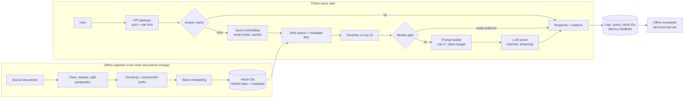

# RAG Pipeline Evaluation: Results, Failure Analysis and System Design

Home-gardening guide (Indonesian agricultural extension text, English translation) · 3 embedding models × 3 chunking strategies × 5 queries = **45 runs**, top-k = 3.

---

## 0. Key findings

1. **The recorded automated scores cannot be trusted.** All 45 answers are marked `Poor (0% keywords)`, and 35 of 45 retrievals are marked `Poor`. Yet on a manual re-check, **35 of 45 answers (78%) are correct or nearly so (score ≥ 4/5)**, and the answer-bearing chunk was in the top 3 in **41 of 45 runs (plus 1 partial)**. The gold paragraph IDs and the keyword matcher are the problem, not the pipeline (section 4, F1).
2. **Retrieval mostly works; generation is where the remaining errors come from.** Of the 6 answers scoring ≤ 2, only 3 follow a retrieval miss. The other 3 had the right chunk in context and still mixed up crops or numbers.
3. **Overlap chunking is the most robust**: perfect retrieval (15/15) and a manual score of 4.6/5 with every embedding model. Hybrid chunking has the best single result (medium + hybrid, 4.8) and the worst two (small + hybrid, 3.4; large + hybrid, 3.6).
4. **A larger embedding model gave no consistent gain.** Manual scores were 4.13 (small), 4.47 (medium) and 4.20 (large), differences within the noise of 5 queries per cell. The large model's cosine scores are compressed into 0.81–0.92, which makes score thresholds unreliable.
5. **Generation is ~98% of latency.** Median retrieval was ~120 ms; median generation was ~5.0 s. Prompts averaged ~465 tokens.

---

## 1. Setup

| Dimension | Values |
|---|---|
| Embedding models | small (384d), medium (768d), large (1024d) |
| Chunking | fixed (`FIX-*`), overlap (`OVL-*`), hybrid with section header (`HYB-*`) |
| Queries | 5 (Q1–Q5 below) |
| Retrieval | top-3 by cosine similarity |
| Generator | same model for all runs, answers from retrieved context only |
| Source | one document, paragraphs `P001`–`P057`+ |

### 1.1 Ground truth (taken from the source text in the retrieved chunks)

| Query | Correct answer | Where it lives in the source |
|---|---|---|
| Q1 Growing medium for pots/polybags/vertical gardens | 1 : 1 : 1 topsoil : rice-husk charcoal : compost/manure | P012–P013 (also P018/P025) |
| Q2 Celery germination and harvest | Germinates in 7–12 days; harvest at 90–125 days | P034, P037 |
| Q3 Spinach seedling transplant | 7–15 days old, with ≥ 3 true leaves | P015 |
| Q4 Tomato spacing and pot size | Beds: 70×70 cm or 60×70 cm. Polybags/pots: diameter > 50 cm | P047, P052, P057 |
| Q5 Spinach water and pests | 4 L/m²/day up to 7 days, ~8 L/m²/day near maturity. Leaf caterpillars, aphids, leaf miners, grasshoppers | P023 |

---

## 2. Evaluation tables

### 2.1 Automated results as recorded in `evaluation_table.csv`

| Config | Context quality (5 queries) | Mean P@3 | Mean R@3 | Mean MRR | Answer quality |
|---|---|---|---|---|---|
| small + fixed | 2 Partial, 3 Poor | 0.13 | 0.40 | 0.13 | 5 × Poor (0% keywords) |
| small + overlap | 1 Good, 4 Poor | 0.07 | 0.20 | 0.20 | 5 × Poor |
| small + hybrid | 1 Good, 4 Poor | 0.07 | 0.20 | 0.20 | 5 × Poor |
| medium + fixed | 1 Good, 4 Poor | 0.07 | 0.20 | 0.20 | 5 × Poor |
| medium + overlap | 1 Good, 4 Poor | 0.07 | 0.20 | 0.20 | 5 × Poor |
| medium + hybrid | 1 Partial, 4 Poor | 0.07 | 0.20 | 0.10 | 5 × Poor |
| large + fixed | 1 Good, 4 Poor | 0.07 | 0.20 | 0.20 | 5 × Poor |
| large + overlap | 1 Good, 4 Poor | 0.07 | 0.20 | 0.20 | 5 × Poor |
| large + hybrid | 1 Partial, 4 Poor | 0.07 | 0.20 | 0.07 | 5 × Poor |
| **All 45 runs** | 6 Good, 4 Partial, 35 Poor | 0.07 | 0.22 | 0.17 | **45 × Poor** |

These numbers do not distinguish the configurations, and they contradict the actual answers. Section 4 (F1) explains why. The `Manual Answer Score (1-5)` and `Team Notes` columns in the CSV are empty.

### 2.2 Manual re-assessment (my scoring, 1–5, against the ground truth above)

Rubric: **5** = all facts correct and complete · **4** = correct, one minor omission (e.g. gives 70×70 but not the 60×70 alternative) · **3** = partly correct or contains an unsupported addition · **2** = mostly wrong or incomplete · **1** = wrong, hallucinated or no usable answer.

Each cell shows `score · retrieval`. Retrieval: ✓ = the chunk(s) containing the answer were in the top 3, ~ = only part of the answer was there, ✗ = absent.

| Config | Q1 medium | Q2 celery | Q3 transplant | Q4 tomato | Q5 water/pests | Total /25 | Avg |
|---|---|---|---|---|---|---|---|
| small + fixed | 5 · ✓ | 5 · ✓ | 5 · ✓ | 2 · ~ | 5 · ✓ | 22 | 4.4 |
| small + overlap | 5 · ✓ | 5 · ✓ | 5 · ✓ | 3 · ✓ | 5 · ✓ | 23 | 4.6 |
| small + hybrid | 5 · ✓ | 5 · ✓ | 2 · ✓ | 1 · ✗ | 4 · ✓ | 17 | 3.4 |
| medium + fixed | 1 · ✗ | 5 · ✓ | 5 · ✓ | 4 · ✓ | 5 · ✓ | 20 | 4.0 |
| medium + overlap | 5 · ✓ | 5 · ✓ | 5 · ✓ | 3 · ✓ | 5 · ✓ | 23 | 4.6 |
| medium + hybrid | 5 · ✓ | 5 · ✓ | 5 · ✓ | 5 · ✓ | 4 · ✓ | 24 | 4.8 |
| large + fixed | 5 · ✓ | 5 · ✓ | 5 · ✓ | 4 · ✓ | 3 · ✓ | 22 | 4.4 |
| large + overlap | 5 · ✓ | 5 · ✓ | 3 · ✓ | 5 · ✓ | 5 · ✓ | 23 | 4.6 |
| large + hybrid | 2 · ✗ | 5 · ✓ | 5 · ✓ | 4 · ✓ | 2 · ✓ | 18 | 3.6 |
| **Query average** | **4.22** | **5.00** | **4.44** | **3.44** | **4.22** | **192/225** | **4.27** |

Distribution: 35 runs scored 4–5, 4 runs scored 3, 6 runs scored ≤ 2. Retrieval: 41 ✓, 1 ~, 3 ✗.

**Why each run below 5 lost points**

| Run | Score | What went wrong |
|---|---|---|
| medium + fixed, Q1 | 1 | Retrieved chunks had no mix recipe, and the model invented "compost or vermiculite" (vermiculite is not in the source). **Hallucination.** |
| large + hybrid, Q1 | 2 | Retrieved two spacing chunks instead of the mix. It abstained ("document does not specify"), which is faithful but unhelpful. |
| small + hybrid, Q3 | 2 | Right chunk (HYB-009) was retrieved, but the answer led with "30–35 days / 5–6 leaves" from a celery/scallion chunk, then appended the 3-true-leaves sign. |
| large + overlap, Q3 | 3 | Answered "about 12 days", taken from the kangkung-specific chunk. It missed the general 7–15 day range. |
| small + fixed, Q4 | 2 | Beds were right. For pots it gave "1 seedling per polybag, 15 or 25 cm", which belongs to other crops. The > 50 cm diameter chunk was not retrieved. |
| small + overlap, Q4 | 3 | Correct 70×70 and > 50 cm, plus an unsupported claim that polybags use "the same 70×70 spacing". |
| medium + overlap, Q4 | 3 | Same unsupported addition as above. |
| small + hybrid, Q4 | 1 | Answered "about 15 cm" (another crop's spacing). Missed both correct values. |
| medium + fixed, large + fixed, large + hybrid, Q4 | 4 | Correct, but omitted the 60×70 alternative. |
| small + hybrid, medium + hybrid, Q5 | 4 | Facts correct, wording garbled ("up to 7 days of age 4 liters"). |
| large + fixed, Q5 | 3 | Gave only the 8 L figure and dropped the 4 L young-plant figure. |
| large + hybrid, Q5 | 2 | "Up to 7 liters per m² for the first 7 days." The 7 was the day count, not the volume, and the correct figure is 4 L. |

### 2.3 Latency and prompt size

| Config | Median total (ms) | Mean retrieval (ms) | Median generation (ms) | Mean prompt tokens |
|---|---|---|---|---|
| small + fixed | 9,249 | 249 (1,275 incl. cold start) | 9,032 | 483 |
| small + overlap | 5,986 | 210 | 5,757 | 488 |
| small + hybrid | 4,274 | 109 | 4,114 | 399 |
| medium + fixed | 4,850 | 134 | 4,797 | 488 |
| medium + overlap | 4,769 | 123 | 4,590 | 481 |
| medium + hybrid | 5,260 | 142 | 5,074 | 457 |
| large + fixed | 5,763 | 117 | 5,703 | 494 |
| large + overlap | 4,910 | 100 | 4,786 | 497 |
| large + hybrid | 4,811 | 129 | 4,724 | 399 |
| **All runs** | **~5,100** | **median 121** | **median 5,001** (range 2,990–40,394) | **465** (range 315–668) |

The first run (small + fixed, Q1) took 45.8 s, with 5.4 s of retrieval and 40.4 s of generation. That looks like a cold start and should be excluded from comparisons. Runs were sequential, so ordering effects (warm-up, caching) probably explain why the large model shows the *lowest* retrieval median (91 ms) despite having the most dimensions. Do not read the retrieval latencies as model speed.

---

## 3. Comparisons

### 3.1 By embedding model

| Model | Manual score (/5) | Answer chunk in top-3 (of 15) | Top-3 score range | Median retrieval (ms) |
|---|---|---|---|---|
| small (384d) | 4.13 | 13 + 1 partial | 0.44–0.81 | 173 |
| medium (768d) | 4.47 | 14 | 0.45–0.82 | 143 |
| large (1024d) | 4.20 | 14 | 0.81–0.92 | 91 |

- Medium looks best, but 0.3 points across 75 answers amounts to about two answers, which is noise.
- Both misses for medium and large were on Q1, and each coincided with a different chunker (fixed and hybrid).
- The large model's top-3 scores fall into a band only 0.11 wide. It ranked two irrelevant spacing chunks at 0.856 and 0.855 for Q1, almost tied with correct-topic chunks. Small and medium spread their scores more, which makes thresholds easier to set.
- 3× storage and compute for 1024d buys nothing measurable here.

### 3.2 By chunking strategy

| Strategy | Manual score (/5) | Answer chunk in top-3 (of 15) | Mean prompt tokens | Behavior |
|---|---|---|---|---|
| fixed | 4.27 | 13 + 1 partial | 488 | Merges unrelated crops into one chunk |
| overlap | **4.60** | **15** | 488 | Duplicates text across neighbours, but never missed |
| hybrid | 3.93 | 13 | **418** (−14%) | Cheapest prompts, highest variance |

- Overlap scored 4.6 with all three embedding models. Fixed ranged 4.0–4.4 and hybrid ranged 3.4–4.8.
- Hybrid's per-model swing is the largest. Its short, section-labelled chunks (e.g. `[PLANTING] Plant 1 seedling per polybag… 15 cm`) **drop the crop name**, so they match any "spacing" or "planting" query regardless of crop. That is consistent with 4 of the 6 lowest-scoring answers being hybrid runs. The cause is a hypothesis; I did not run an ablation.
- Hybrid cut prompt size by 14%. That saving is real, but it matters only if answers stay correct.

### 3.3 By query

| Query | Avg score | Why |
|---|---|---|
| Q2 celery | **5.00** | Both facts sit in clearly crop-labelled chunks. |
| Q3 transplant | 4.44 | Generic seedling steps. Right chunk found 9/9, but 2 runs were pulled toward crop-specific numbers. |
| Q1 medium | 4.22 | 2 retrieval misses. One became a hallucination, one an abstention. |
| Q5 water/pests | 4.22 | Retrieved 9/9. Errors came from number/day confusion in generation. |
| Q4 tomato | **3.44** | Two-part answer spread across chunks, near-duplicate paragraphs, and a generic pot-size chunk that competes for a slot. |

---

## 4. Failure analysis

### F1: The evaluation harness mislabels good results as failures (highest impact)

Evidence:
- **Q2:** all 9 runs retrieved the chunks stating "7–12 days" and "90–125 days", and all 9 answered correctly. All 9 are recorded as `Poor`, with notes "missed gold ['P002','P003']".
- The "gold" IDs are P001, P002/P003, P004 and P006. They look like the first paragraphs of the document (intro and pot sections), not the paragraphs that contain each answer (P012–P013, P034/P037, P015, P023). This is my inference from comparing gold IDs to chunk text, not something the CSV states.
- As a result the automated metrics rate **Q4 as the best-retrieved query** (it hits the generic pot-size chunk P004), while manual review shows Q4 is the **hardest**.
- The keyword matcher compares the answer against a full expected sentence, so it returns 0% even for a verbatim-correct answer (e.g. "1 part topsoil, 1 part rice husk charcoal, 1 part compost/manure" against "a 1:1:1 ratio of topsoil, rice husk charcoal, and compost/manure").

Fix: relabel gold by fact, not by paragraph ID, and judge by fact-level checks ("contains 7–12 days", "contains 90–125 days") or an LLM judge. Judge retrieval by whether the chunk contains the fact, so metrics survive any re-chunking. Fill in the manual score column.

### F2: Retrieval misses (3 of 45)

| Run | What was retrieved instead | Likely cause |
|---|---|---|
| medium + fixed, Q1 | Pot-size chunk, vertical-gardening definition, bed-prep chunk | "Pots/polybags/vertical gardens" matches descriptive chunks better than the recipe chunk. |
| large + hybrid, Q1 | Pot-size chunk and two `[PLANTING]` spacing chunks | Compressed large-model scores; the short spacing chunks look topical. |
| small + hybrid, Q4 | 15 cm and 25 cm spacing chunks (other crops) | Chunk lost its crop name, so it looks like tomato spacing. |

The pot-size hub chunk (`FIX-004` / `HYB-004`, "Pots and Polybags") was retrieved in **all 9 Q4 runs** and ranked first in 6 of 9 Q1 runs. It contains a different pot size for vegetables (20–30 cm) than the tomato guidance (> 50 cm). It did not cause a wrong answer here, but it is a standing risk.

### F3: Generation errors with the right context in hand (3 of the 6 lowest-scoring answers)

- **Crop mixing:** small + hybrid Q3 took 30–35 days / 5–6 leaves from a celery/scallion chunk. small + fixed Q4 took 15/25 cm from other crops.
- **Number/unit confusion:** large + hybrid Q5 turned "up to 7 days of age" into "7 liters". Two other runs produced the same "up to 7 days of age 4 liters" run-on.
- **Unsupported extension:** two overlap runs claimed polybags use the same 70×70 spacing.
- **Incomplete answers:** dropped the 60×70 alternative (3 runs) or the 4 L figure (1 run).

### F4: Faithfulness when context is missing

With the same missing-recipe situation in Q1, medium + fixed **invented** an answer (vermiculite) while large + hybrid **abstained**. Only the second is acceptable behavior. The current prompt does not enforce abstention.

### F5: Corpus and chunking problems

- **Near-duplicate paragraphs** use up top-k slots: P018/P025 (identical recipe), P030/P035 (differ only 15 vs 25 cm), P047/P057 ("plastic mulch" vs "plastic"). In large + hybrid Q4, ranks 1 and 2 are the same content.
- **Fixed chunks merge crops:** `FIX-020` joins a pakchoi sentence with the celery harvest line, and `FIX-025` joins tomato spacing with scallion text. Retrieval gets the right fact together with off-topic text, which feeds F3.
- **Hybrid split a sentence from its list:** `HYB-007` ends with "prepare a growing medium consisting of a mixture of:" and the list itself is in `HYB-008`.
- **Overlap chunks repeat text** (e.g. `OVL-044` and `OVL-045` each contain the same two bullets), which wastes tokens.
- **Spinach vs water spinach (kangkung):** the source covers both, and chunks about kangkung appear in spinach queries (e.g. Q5 ranks 2–3).
- **Source typo:** the seed-soaking step says "warm water (300°C)", almost certainly 30°C. It appears in every chunk that carries that step and should be corrected at the source.

### F6: Measurement noise

One 45.8 s cold-start run distorts any average that includes it. Each cell has only 5 queries, one run each, so single answers swing a configuration's score by 0.2–0.8.

### Recommended fixes, in priority order

| # | Fix | Targets |
|---|---|---|
| 1 | Re-annotate gold at the fact level and replace the keyword matcher | F1 |
| 2 | Prefix every chunk with crop and section (e.g. `Tomato › Planting`) | F2, F3, F5 |
| 3 | Deduplicate near-identical paragraphs; never split a sentence from its list | F5 |
| 4 | Use overlap chunking as the baseline; keep hybrid only if the prefix fix closes its variance | Section 3.2 |
| 5 | Grounding prompt: answer only for the named crop, quote numbers and units verbatim, give all alternatives, abstain if the fact is absent | F3, F4 |
| 6 | Add BM25 + a cross-encoder reranker (top-20 → top-3) | F2 |
| 7 | Calibrate any score threshold per embedding model (large needs a different range) | Section 3.1 |

---

## 5. System design: scaling to 10,000 users/day

Figures from this notebook run are marked **measured**. Items marked ⚠ come from experiments not included in the files I received (top-k sweep, MRR table, data-scaling test) and need your own numbers.

### 5.1 Starting point: the prototype

| Component | Prototype | Limitation at scale |
|---|---|---|
| Knowledge base | One document, ~57+ paragraphs | Manual loading; no incremental updates |
| Chunking | Fixed / overlap / hybrid, built in memory | Re-chunks the whole corpus every run |
| Embeddings | 3 sentence-transformer models (384 / 768 / 1024 dims) | Reloaded each session; corpus re-embedded each run |
| Vector store | In-memory matrix | Exact search over all vectors, single process |
| Generation | Local model, one request at a time | No batching or concurrency |
| Evaluation | 5 hand-labelled queries | No monitoring of real traffic |

**Measured:** retrieval median **~120 ms**; generation median **~5.0 s** (range 3.0–10.8 s excluding the cold start). **The LLM is the bottleneck, not vector search**, and that drives most of the design.

### 5.2 Load estimate

| Assumption | Value |
|---|---|
| Users per day | 10,000 |
| Questions per user per day | ~5 |
| **Queries per day** | **~50,000** |
| Average load | 50,000 / 86,400 s ≈ **0.6 queries/s** |
| Peak (traffic concentrated, ~10× average) | **~6 queries/s** |
| Design target (headroom) | **10–20 queries/s** |
| Prompt at top-k = 3 | **~465 input tokens (measured)** + ~150 output tokens |
| **Tokens per day** | 50,000 × ~615 ≈ **31M tokens/day** |
| Concurrent LLM requests at peak | 6 QPS × ~5 s (measured median) ≈ **~30 in flight** |

The earlier draft assumed 3 s per answer (~18 in flight). With the measured 5 s it is ~30. A production inference server with batching should answer faster than the notebook's setup, so treat 30 as the conservative planning number.

### 5.3 Architecture

### 5.4 How it scales

**Ingestion becomes an offline pipeline.**
- Chunk and embed once, when documents are added or changed, not per request.
- Store a content hash per chunk so an edited document re-embeds only the changed chunks.
- Dedupe near-identical paragraphs and add the crop/section prefix at ingestion (section 4, F2/F5). Chunking choice: start from overlap, and promote hybrid only if the prefix fix removes its variance. The current evidence does not show hybrid as the best overall.

**Vector store: from an in-memory matrix to an ANN index.**
- Use FAISS HNSW, pgvector, Qdrant or Chroma. HNSW keeps search at a few milliseconds even at millions of chunks, trading a little recall for speed. Exact search is fine for the current corpus.
- Store metadata (crop, section, document, date) and filter before ranking. This directly addresses the cross-crop confusion seen here (F2/F3).
- ⚠ The earlier draft cites a data-scaling experiment (Step 2.5) showing more documents add more look-alike distractors; I did not have those results.

| Corpus size | 384 dims | 768 dims | 1024 dims |
|---|---|---|---|
| 10K chunks | 15 MB | 29 MB | 39 MB |
| 100K chunks | 147 MB | 293 MB | 391 MB |
| 1M chunks | 1.5 GB | 2.9 GB | 3.9 GB |

*(float32; halve with float16, quarter with int8.)* Storage is not the constraint.

**Stateless API layer.**
- A small service (e.g. FastAPI) runs retrieval, 2–3 replicas behind a load balancer.
- The small embedding model runs on CPU inside the API service, so no separate GPU is needed for embeddings.
- The gateway handles authentication and per-user rate limits.

**LLM serving: the real bottleneck.**

| Option | How it scales | Choose when |
|---|---|---|
| Self-hosted model on vLLM or Text Generation Inference | Continuous batching serves many requests on one GPU; ~30 concurrent at peak fits 1–2 GPUs for a small-to-mid model, plus a replica for redundancy | Steady traffic, privacy needs |
| Hosted LLM API | Provider scales; you manage rate limits, retries, fallbacks | Spiky traffic, small team, fast launch |

For both:
- **Stream tokens** so the first words appear in well under a second even when the full answer takes ~5 s.
- Set timeouts and a fallback (smaller model or "try again") so one slow request never blocks the queue.

**Caching.**
- **Answer cache** keyed by normalised query or query-embedding similarity. Each hit skips the LLM. Even a 20–30% hit rate removes that share of LLM cost.
- **Embedding cache** for repeated queries.
- **Invalidation:** clear cached answers whose source chunks changed.

### 5.5 What to optimize

1. **Prompt size (biggest cost lever).** Measured: ~465 tokens at k = 3 (range 315–668). Hybrid chunks averaged 418 vs 488 for fixed/overlap (−14%). Keep k = 3 and enforce a token budget in the prompt builder. Retrieval already put the answer chunk in the top 3 in 41/45 runs, so a larger k is not the first fix. ⚠ The earlier draft's k = 1/3/5 token sweep (~250 / ~540 / ~890) is from a notebook cell I did not receive.
2. **Retrieval quality so a small k suffices.** BM25 + embedding hybrid search; a cross-encoder reranker on the top 20; metadata filters by crop; query rewriting only when the top score is low.
3. **Embedding model: use the smallest.** Measured: small, medium and large were statistically indistinguishable (manual 4.13 / 4.47 / 4.20; answer in top-3 13+1 / 14 / 14 of 15), at 1×, 2× and 2.7× vector size. Quantize vectors to float16 or int8. ⚠ Cite the MRR numbers from Step 2.3 if they differ.
4. **Generation.**
   - Grounding prompt: answer only for the named crop, quote numbers and units exactly, list all alternatives, cite chunk IDs, abstain with a fixed sentence when the fact is absent (fixes F3/F4).
   - **Abstain gate:** if the best reranker score is below a threshold, return "I don't know based on the provided documents" without calling the LLM. Calibrate thresholds per embedding model, because the large model's scores are compressed to 0.81–0.92.
   - Quantize the LLM (8-bit/4-bit) to fit more concurrent requests per GPU; route simple lookups to a smaller model; cap `max_new_tokens`.
5. **Monitoring and continuous evaluation.**
   - Log query, chunk IDs and scores, prompt tokens, per-stage latency, answer and thumbs up/down.
   - Targets: p95 < 5 s end to end, < 1 s to first token. Alert on error rate, cache hit rate, tokens/day and abstention rate.
   - **Re-run a fact-level test set** (not the current gold-ID/keyword harness) on every change to chunking, embeddings, prompt or LLM. Add real failed queries from the logs.

### 5.6 Rough daily cost

| Item | Estimate |
|---|---|
| LLM tokens (hosted API) | ~31M tokens/day. At an **assumed** blended $0.50 per 1M tokens ≈ **$15/day**; a 25% cache hit rate saves about a quarter. Replace with your provider's real input/output prices. |
| LLM (self-hosted) | 1–2 GPU instances running continuously; fixed cost, independent of volume |
| API + embeddings | 2–3 small CPU instances |
| Vector DB | Under 1 GB even at 100K chunks |

The LLM dominates cost in both options, which is why prompt size, caching and the abstain gate matter most.

### 5.7 Trade-offs

| Decision | Choice | Trade-off accepted |
|---|---|---|
| Search | ANN (HNSW) over exact search | Tiny recall loss for millisecond search at scale |
| Embedding model | Smallest that meets the quality target | Possibly a few points of retrieval quality for 2–3× lower cost |
| Top-k | 3, with a reranker | Reranker adds ~50–100 ms (estimate) but keeps prompts short |
| Chunking | Overlap + crop/section prefix, deduped | More ingestion work; overlap repeats some text |
| Caching | Answer + embedding cache | Must invalidate when documents change |
| LLM | Batched serving, streaming, abstain gate | Infrastructure to run, in exchange for lower latency and fewer hallucinations |

---

## 6. Limitations

- **Small sample:** 5 queries, one document, one run per cell. Differences below ~0.5 points between configurations are not meaningful.
- **Single judge:** the manual scores in section 2.2 are my assessment against the source text in the retrieved chunks. A second reviewer should confirm the 4 "3-score" and 6 "≤2" cases.
- **Generator unspecified:** the same model was used throughout, but its size and hardware are not in the files, so absolute latencies will not transfer to production.
- **Latency order effects:** runs were sequential, so warm-up affects early runs.
- **Retrieval metrics in 2.1** are reproduced as recorded; they are not corrected here, only explained.
