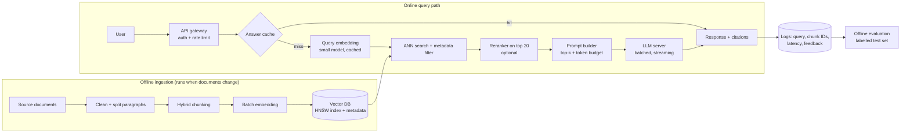

# Retrieved chunks for every configuration


## small embedding x fixed chunking


### Q1: What growing medium mix should be used for pots, polybags, and vertical gardens?
- Context quality: **Partial** | Answer quality: **Poor**

- [1] score 0.622, FIX-004 ['P004', 'P005', 'P006']

  > - Choose the type and size (diameter) of pot or polybag to suit the plant being grown. - For perennial plants, generally fruit plants, choose a pot made from a drum/can or a pot with a diameter of about 60 cm. - For medicinal plants or vegetables, a plastic pot or polybag with a diameter of 20–30 cm can be used. Plants that can be grown in pots and polybags include: 1. Several kinds of fruit, known as *Tabulampot* (fruit plants in pots), for example: water apple, bell apple, sapodilla, mango, citrus, etc. 2. Fruiting vegetables and leafy vegetables, for example: chili, eggplant, tomato, mustard greens, lettuce, etc. 3. Medicinal plants, for example: turmeric, cat's whiskers, ginger-family plants (rhizomes), etc.

- [2] score 0.591, FIX-011 ['P018', 'P025']

  > 1. Planting can be done in polybags, pots, or with vertical gardening. 2. Use a growing medium of soil plus manure plus husk/rice husk charcoal, in a 1:1:1 ratio. 3. Scatter the seeds over the medium, cover thinly with soil, then water. 1. Planting can be done in polybags, pots, or with vertical gardening. 2. Use a growing medium of soil + manure + husk/rice husk charcoal, in a 1:1:1 ratio. 3. Scatter the seeds over the medium, cover thinly with soil, then water.

- [3 RELEVANT] score 0.554, FIX-001 ['P001']

  > In-ground beds (raised beds/*bedengan*), which can be combined with pots, polybags, and vertical gardening (*vertikultur*). With a large yard, we have more freedom to grow plants at home. Options include: in-ground beds, which can be combined with pots, polybags, and vertical gardening.


**Answer:** For pots, polybags, and vertical gardens, a growing medium of soil plus manure plus husk/rice husk charcoal, in a 1:1:1 ratio, should be used.


### Q2: How long does celery take to germinate, and when can it be harvested?
- Context quality: **Poor** | Answer quality: **Poor**

- [1] score 0.767, FIX-009 ['P034', 'P041', 'P046', 'P051']

  > - Celery seeds are planted shallow to speed up seedling emergence. - Celery germination is very slow and takes 7–12 days. - When the plants are 2 months old, celery can be moved to the field, or to pots, polybags, or vertical gardens. - Seed material can come from shoots. - Offset shoots are obtained by separating healthy, well-growing offsets from the mother plant. Seedlings about 30–35 days after sowing, or with 5–6 leaves, are ready to be moved to the field. - Seedlings about 7–8 days after sowing are moved into banana-leaf/plastic pouches. - After 4–5 weeks, the seedlings are ready to be planted in the field, or in polybags or pots.

- [2] score 0.675, FIX-021 ['P037', 'P044']

  > Harvesting is done by pulling up the plant. - Leaf celery has a shorter growing season, and it can be harvested repeatedly if the leaves are cut high enough above the soil surface to allow new leaves to grow back. - These include leaf miner flies, bacterial leaf spot, bacterial soft rot, fusarium disease, cercospora leaf blight, damping-off, root rot, and various viruses. - OPT control is adjusted to the OPT that is attacking; if insecticide must be used, use a safe type that breaks down easily, such as biological or botanical insecticides. Scallion plants can begin to be harvested 2 months after planting. Harvesting is done by pulling up the entire plant, including the roots.

- [3] score 0.668, FIX-020 ['P028', 'P032', 'P037']

  > Because it is easy to care for, caisin or mustard is widely grown in home yards. After about 45 days after planting, pakchoi can be harvested. - Celery can be harvested at 90–125 days.


**Answer:** Celery takes 7–12 days to germinate. It can be harvested between 90–125 days after planting.


### Q3: When are spinach seedlings ready to transplant, and what signs show they’re ready?
- Context quality: **Poor** | Answer quality: **Poor**

- [1] score 0.706, FIX-007 ['P015', 'P016']

  > Discard seeds that are bad (floating). 5. Scatter the seeds in the seeding tray, cover thinly with seeding medium, then water. 6. Water in the morning and evening. 7. Seedlings are generally ready to be transplanted at 7–15 days old (depending on the type of plant). 8. Signs a seedling is ready to transplant: good growth and at least 3 true leaves. **Water spinach (*kangkung*)** is a leafy vegetable that is widely consumed by Indonesians. Water spinach contains a lot of *pro-vitamin A*. Water spinach can be propagated from cuttings or from seed. Water spinach seeds are currently easy to find on the market.

- [2] score 0.479, FIX-010 ['P056']

  > - Recommended varieties include: Opal, Mirah, Jamrud, Permata, Martha, and others. - Seedlings about 7–8 days after sowing are moved into banana-leaf/plastic pouches. - After 3 weeks, the seedlings are ready to be planted in the field, or in polybags or pots.

- [3] score 0.443, FIX-008 ['P017', 'P024', 'P029']

  > There are two types of water spinach known in Indonesia, distinguished by where they grow: aquatic water spinach and upland water spinach. Aquatic water spinach is a water plant found across Southeast Asia, India, and southeastern China. Upland water spinach, meanwhile, is the type commonly grown in home yards. Spinach is propagated from seed. Some recommended varieties include: Giti Hijau, Giti Merah, Kakap Hijau, Bangkok, and Cimangkok. When the sown seedlings are about 12 days old, they are ready to be planted into pots/polybags, vertical gardens, or directly in beds.


**Answer:** Spinach seedlings are generally ready to be transplanted at 7–15 days old, depending on the type of plant. Signs that a spinach seedling is ready to transplant include good growth and at least 3 true leaves.


### Q4: What spacing and pot size does the guide recommend for tomatoes grown in beds versus polybags or pots?
- Context quality: **Partial** | Answer quality: **Poor**

- [1] score 0.576, FIX-031 ['P055']

  > **Tomato** is a fruiting vegetable commodity that housewives always need for preparing food. Tomatoes can be grown widely from the lowlands to the highlands, on former rice-field land and on dry land. Besides being planted directly in the ground, tomatoes can also be grown in polybags/pots.

- [2] score 0.565, FIX-025 ['P030', 'P035', 'P042', 'P047']

  > Plant 1 seedling per polybag. If planted in a vertical garden or bed, use a spacing of about 15 cm. Plant 1 seedling per polybag. If planted in a vertical garden or bed, use a spacing of about 25 cm. - Scallions can be planted directly in beds, or in pots, polybags, or vertical gardens. - Planting is done by making a small planting hole, placing the seedling or offset shoot upright, covering it with soil again, and watering. - If planted in beds, use a spacing of 70 cm x 70 cm or 60 cm x 70 cm.

- [3 RELEVANT] score 0.565, FIX-004 ['P004', 'P005', 'P006']

  > - Choose the type and size (diameter) of pot or polybag to suit the plant being grown. - For perennial plants, generally fruit plants, choose a pot made from a drum/can or a pot with a diameter of about 60 cm. - For medicinal plants or vegetables, a plastic pot or polybag with a diameter of 20–30 cm can be used. Plants that can be grown in pots and polybags include: 1. Several kinds of fruit, known as *Tabulampot* (fruit plants in pots), for example: water apple, bell apple, sapodilla, mango, citrus, etc. 2. Fruiting vegetables and leafy vegetables, for example: chili, eggplant, tomato, mustard greens, lettuce, etc. 3. Medicinal plants, for example: turmeric, cat's whiskers, ginger-family plants (rhizomes), etc.


**Answer:** For tomatoes grown in beds, the guide recommends a spacing of 70 cm x 70 cm or 60 cm x 70 cm. When grown in polybags or pots, the recommendation is to plant 1 seedling per polybag with a spacing of either 15 cm or 25 cm depending on whether they are planted in a vertical garden or bed.


### Q5: How much water per day does spinach need, and what pests commonly attack it?
- Context quality: **Poor** | Answer quality: **Poor**

- [1] score 0.760, FIX-014 ['P020', 'P023']

  > Keep water available by watering in the morning and evening (if it is not raining), and protect the plants from pests and diseases. - Pay attention to water needs. - Up to 7 days of age, the plants need 4 liters of water/m² per day. - As they approach maturity, they need about 8 liters of water/m² per day. - Pests that often attack spinach include leaf caterpillars, aphids, leaf miners, and grasshoppers. - Pest control can be done mechanically, by catching the pests directly. However, if insecticide must be used, use a safe type that breaks down easily, such as biological insecticides and botanical (plant-based) insecticides.

- [2] score 0.553, FIX-007 ['P015', 'P016']

  > Discard seeds that are bad (floating). 5. Scatter the seeds in the seeding tray, cover thinly with seeding medium, then water. 6. Water in the morning and evening. 7. Seedlings are generally ready to be transplanted at 7–15 days old (depending on the type of plant). 8. Signs a seedling is ready to transplant: good growth and at least 3 true leaves. **Water spinach (*kangkung*)** is a leafy vegetable that is widely consumed by Indonesians. Water spinach contains a lot of *pro-vitamin A*. Water spinach can be propagated from cuttings or from seed. Water spinach seeds are currently easy to find on the market.

- [3] score 0.509, FIX-008 ['P017', 'P024', 'P029']

  > There are two types of water spinach known in Indonesia, distinguished by where they grow: aquatic water spinach and upland water spinach. Aquatic water spinach is a water plant found across Southeast Asia, India, and southeastern China. Upland water spinach, meanwhile, is the type commonly grown in home yards. Spinach is propagated from seed. Some recommended varieties include: Giti Hijau, Giti Merah, Kakap Hijau, Bangkok, and Cimangkok. When the sown seedlings are about 12 days old, they are ready to be planted into pots/polybags, vertical gardens, or directly in beds.


**Answer:** Spinach, including water spinach, needs 4 liters of water per m² per day when young and up to 8 liters per m² per day as it approaches maturity. Common pests that attack spinach include leaf caterpillars, aphids, leaf miners, and grasshoppers.


## small embedding x overlap chunking


### Q1: What growing medium mix should be used for pots, polybags, and vertical gardens?
- Context quality: **Poor** | Answer quality: **Poor**

- [1] score 0.711, OVL-010 ['P012', 'P013']

  > For plants grown in pots, polybags, and vertical gardens, prepare a growing medium consisting of a mixture of: 1 part topsoil 1 part rice husk charcoal 1 part compost/manure

- [2] score 0.623, OVL-004 ['P004', 'P005']

  > - Choose the type and size (diameter) of pot or polybag to suit the plant being grown. - For perennial plants, generally fruit plants, choose a pot made from a drum/can or a pot with a diameter of about 60 cm. - For medicinal plants or vegetables, a plastic pot or polybag with a diameter of 20–30 cm can be used. Plants that can be grown in pots and polybags include:

- [3] score 0.604, OVL-005 ['P005', 'P006']

  > Plants that can be grown in pots and polybags include: 1. Several kinds of fruit, known as *Tabulampot* (fruit plants in pots), for example: water apple, bell apple, sapodilla, mango, citrus, etc. 2. Fruiting vegetables and leafy vegetables, for example: chili, eggplant, tomato, mustard greens, lettuce, etc. 3. Medicinal plants, for example: turmeric, cat's whiskers, ginger-family plants (rhizomes), etc.


**Answer:** For pots, polybags, and vertical gardens, a growing medium consisting of a mixture of 1 part topsoil, 1 part rice husk charcoal, and 1 part compost/manure should be used.


### Q2: How long does celery take to germinate, and when can it be harvested?
- Context quality: **Poor** | Answer quality: **Poor**

- [1] score 0.782, OVL-017 ['P034', 'P041']

  > - Celery seeds are planted shallow to speed up seedling emergence. - Celery germination is very slow and takes 7–12 days. - When the plants are 2 months old, celery can be moved to the field, or to pots, polybags, or vertical gardens. - Seed material can come from shoots. - Offset shoots are obtained by separating healthy, well-growing offsets from the mother plant.

- [2] score 0.767, OVL-034 ['P037', 'P044']

  > - Celery can be harvested at 90–125 days. Harvesting is done by pulling up the plant. - Leaf celery has a shorter growing season, and it can be harvested repeatedly if the leaves are cut high enough above the soil surface to allow new leaves to grow back. - These include leaf miner flies, bacterial leaf spot, bacterial soft rot, fusarium disease, cercospora leaf blight, damping-off, root rot, and various viruses. - OPT control is adjusted to the OPT that is attacking; if insecticide must be used, use a safe type that breaks down easily, such as biological or botanical insecticides. Scallion plants can begin to be harvested 2 months after planting. Harvesting is done by pulling up the entire plant, including the roots.

- [3] score 0.740, OVL-016 ['P029', 'P034']

  > When the sown seedlings are about 12 days old, they are ready to be planted into pots/polybags, vertical gardens, or directly in beds. - Celery seeds are planted shallow to speed up seedling emergence. - Celery germination is very slow and takes 7–12 days. - When the plants are 2 months old, celery can be moved to the field, or to pots, polybags, or vertical gardens.


**Answer:** Celery takes 7–12 days to germinate. It can be harvested between 90–125 days after planting.


### Q3: When are spinach seedlings ready to transplant, and what signs show they’re ready?
- Context quality: **Poor** | Answer quality: **Poor**

- [1] score 0.648, OVL-013 ['P015', 'P016']

  > 1. Prepare a seeding medium made of soil, rice husk charcoal, and compost in a 1:1:1 ratio. 2. Place the medium mixture in a seeding tray. 3. Before sowing, soak the seeds in warm water (300°C) for about 10 minutes. 4. Discard seeds that are bad (floating). 5. Scatter the seeds in the seeding tray, cover thinly with seeding medium, then water. 6. Water in the morning and evening. 7. Seedlings are generally ready to be transplanted at 7–15 days old (depending on the type of plant). 8. Signs a seedling is ready to transplant: good growth and at least 3 true leaves. **Water spinach (*kangkung*)** is a leafy vegetable that is widely consumed by Indonesians. Water spinach contains a lot of *pro-vitamin A*. Water spinach can be propagated from cuttings or from seed. Water spinach seeds are currently easy to find on the market.

- [2] score 0.646, OVL-012 ['P014', 'P015']

  > Steps for preparing vegetable seedlings: 1. Prepare a seeding medium made of soil, rice husk charcoal, and compost in a 1:1:1 ratio. 2. Place the medium mixture in a seeding tray. 3. Before sowing, soak the seeds in warm water (300°C) for about 10 minutes. 4. Discard seeds that are bad (floating). 5. Scatter the seeds in the seeding tray, cover thinly with seeding medium, then water. 6. Water in the morning and evening. 7. Seedlings are generally ready to be transplanted at 7–15 days old (depending on the type of plant). 8. Signs a seedling is ready to transplant: good growth and at least 3 true leaves.

- [3] score 0.615, OVL-015 ['P024', 'P029']

  > Spinach is propagated from seed. Some recommended varieties include: Giti Hijau, Giti Merah, Kakap Hijau, Bangkok, and Cimangkok. When the sown seedlings are about 12 days old, they are ready to be planted into pots/polybags, vertical gardens, or directly in beds.


**Answer:** Spinach seedlings are generally ready to transplant at 7–15 days old, and they are ready when they show good growth and have at least 3 true leaves.


### Q4: What spacing and pot size does the guide recommend for tomatoes grown in beds versus polybags or pots?
- Context quality: **Good** | Answer quality: **Poor**

- [1 RELEVANT] score 0.637, OVL-004 ['P004', 'P005']

  > - Choose the type and size (diameter) of pot or polybag to suit the plant being grown. - For perennial plants, generally fruit plants, choose a pot made from a drum/can or a pot with a diameter of about 60 cm. - For medicinal plants or vegetables, a plastic pot or polybag with a diameter of 20–30 cm can be used. Plants that can be grown in pots and polybags include:

- [2] score 0.592, OVL-041 ['P030', 'P035']

  > Plant 1 seedling per polybag. If planted in a vertical garden or bed, use a spacing of about 15 cm. Plant 1 seedling per polybag. If planted in a vertical garden or bed, use a spacing of about 25 cm.

- [3] score 0.578, OVL-045 ['P052', 'P057']

  > - If planted in beds, use a spacing of 70 cm x 70 cm or 60 cm x 70 cm. At the set spacing, make planting holes in the plastic using a can that has been heated. - Planting holes are made 15–20 cm deep and 20–25 cm in diameter, and left overnight, with the seedlings planted the next day. - If planted in polybags or pots, use ones with a diameter of more than 50 cm. - If planted in beds, use a spacing of 70 cm x 70 cm or 60 cm x 70 cm. At the set spacing, make planting holes in the plastic mulch using a can that has been heated. - Planting holes are made 15–20 cm deep and 20–25 cm in diameter, and left overnight, with the seedlings planted the next day. - If planted in polybags/pots, use polybags/pots with a diameter of more than 50 cm.


**Answer:** The guide recommends planting tomatoes 70 cm x 70 cm apart in beds and using polybags or pots with a diameter of more than 50 cm. For polybags or pots, the same spacing of 70 cm x 70 cm is recommended, but they should have a diameter larger than 50 cm.


### Q5: How much water per day does spinach need, and what pests commonly attack it?
- Context quality: **Poor** | Answer quality: **Poor**

- [1] score 0.760, OVL-023 ['P020', 'P023']

  > Keep water available by watering in the morning and evening (if it is not raining), and protect the plants from pests and diseases. - Pay attention to water needs. - Up to 7 days of age, the plants need 4 liters of water/m² per day. - As they approach maturity, they need about 8 liters of water/m² per day. - Pests that often attack spinach include leaf caterpillars, aphids, leaf miners, and grasshoppers. - Pest control can be done mechanically, by catching the pests directly. However, if insecticide must be used, use a safe type that breaks down easily, such as biological insecticides and botanical (plant-based) insecticides.

- [2] score 0.739, OVL-024 ['P023', 'P031']

  > - Pay attention to water needs. - Up to 7 days of age, the plants need 4 liters of water/m² per day. - As they approach maturity, they need about 8 liters of water/m² per day. - Pests that often attack spinach include leaf caterpillars, aphids, leaf miners, and grasshoppers. - Pest control can be done mechanically, by catching the pests directly. However, if insecticide must be used, use a safe type that breaks down easily, such as biological insecticides and botanical (plant-based) insecticides. - Care activities include watering, follow-up fertilizing, weeding, hilling (mounding soil around the base), and controlling plant-disturbing organisms (OPT). - OPT that commonly attack include leaf caterpillars; they can be controlled by keeping things clean and destroying them directly.

- [3] score 0.523, OVL-013 ['P015', 'P016']

  > 1. Prepare a seeding medium made of soil, rice husk charcoal, and compost in a 1:1:1 ratio. 2. Place the medium mixture in a seeding tray. 3. Before sowing, soak the seeds in warm water (300°C) for about 10 minutes. 4. Discard seeds that are bad (floating). 5. Scatter the seeds in the seeding tray, cover thinly with seeding medium, then water. 6. Water in the morning and evening. 7. Seedlings are generally ready to be transplanted at 7–15 days old (depending on the type of plant). 8. Signs a seedling is ready to transplant: good growth and at least 3 true leaves. **Water spinach (*kangkung*)** is a leafy vegetable that is widely consumed by Indonesians. Water spinach contains a lot of *pro-vitamin A*. Water spinach can be propagated from cuttings or from seed. Water spinach seeds are currently easy to find on the market.


**Answer:** Spinach needs up to 4 liters of water per m² per day when young, and up to 8 liters per m² when approaching maturity. Common pests that attack spinach include leaf caterpillars, aphids, leaf miners, and grasshoppers.


## small embedding x hybrid chunking


### Q1: What growing medium mix should be used for pots, polybags, and vertical gardens?
- Context quality: **Poor** | Answer quality: **Poor**

- [1] score 0.630, HYB-004 ['P004', 'P005', 'P006']

  > [Pots and Polybags] - Choose the type and size (diameter) of pot or polybag to suit the plant being grown. - For perennial plants, generally fruit plants, choose a pot made from a drum/can or a pot with a diameter of about 60 cm. - For medicinal plants or vegetables, a plastic pot or polybag with a diameter of 20–30 cm can be used. Plants that can be grown in pots and polybags include: 1. Several kinds of fruit, known as *Tabulampot* (fruit plants in pots), for example: water apple, bell apple, sapodilla, mango, citrus, etc. 2. Fruiting vegetables and leafy vegetables, for example: chili, eggplant, tomato, mustard greens, lettuce, etc. 3. Medicinal plants, for example: turmeric, cat's whiskers, ginger-family plants (rhizomes), etc.

- [2] score 0.576, HYB-012 ['P018']

  > [(Small yard)] 1. Planting can be done in polybags, pots, or with vertical gardening. 2. Use a growing medium of soil plus manure plus husk/rice husk charcoal, in a 1:1:1 ratio. 3. Scatter the seeds over the medium, cover thinly with soil, then water.

- [3] score 0.567, HYB-019 ['P025']

  > [(Small yard)] 1. Planting can be done in polybags, pots, or with vertical gardening. 2. Use a growing medium of soil + manure + husk/rice husk charcoal, in a 1:1:1 ratio. 3. Scatter the seeds over the medium, cover thinly with soil, then water.


**Answer:** For pots, polybags, and vertical gardens, a growing medium mix of soil plus manure plus husk/rice husk charcoal in a 1:1:1 ratio should be used.


### Q2: How long does celery take to germinate, and when can it be harvested?
- Context quality: **Poor** | Answer quality: **Poor**

- [1] score 0.799, HYB-028 ['P034']

  > [CULTIVATION TECHNIQUES] - Celery seeds are planted shallow to speed up seedling emergence. - Celery germination is very slow and takes 7–12 days. - When the plants are 2 months old, celery can be moved to the field, or to pots, polybags, or vertical gardens.

- [2] score 0.778, HYB-031 ['P037']

  > [HARVEST AND POST-HARVEST] - Celery can be harvested at 90–125 days. Harvesting is done by pulling up the plant. - Leaf celery has a shorter growing season, and it can be harvested repeatedly if the leaves are cut high enough above the soil surface to allow new leaves to grow back. - These include leaf miner flies, bacterial leaf spot, bacterial soft rot, fusarium disease, cercospora leaf blight, damping-off, root rot, and various viruses. - OPT control is adjusted to the OPT that is attacking; if insecticide must be used, use a safe type that breaks down easily, such as biological or botanical insecticides.

- [3] score 0.561, HYB-027 ['P033']

  > [CELERY (*SELEDRI*)] **Celery** is a vegetable commodity widely used as a flavoring and to garnish dishes. Celery seeds are also used as a spice and flavoring. The oil extracted from the seeds has medicinal properties.


**Answer:** Celery takes 7–12 days to germinate and can be harvested between 90–125 days after planting.


### Q3: When are spinach seedlings ready to transplant, and what signs show they’re ready?
- Context quality: **Poor** | Answer quality: **Poor**

- [1] score 0.638, HYB-009 ['P014', 'P015']

  > [GROWING MEDIUM] Steps for preparing vegetable seedlings: 1. Prepare a seeding medium made of soil, rice husk charcoal, and compost in a 1:1:1 ratio. 2. Place the medium mixture in a seeding tray. 3. Before sowing, soak the seeds in warm water (300°C) for about 10 minutes. 4. Discard seeds that are bad (floating). 5. Scatter the seeds in the seeding tray, cover thinly with seeding medium, then water. 6. Water in the morning and evening. 7. Seedlings are generally ready to be transplanted at 7–15 days old (depending on the type of plant). 8. Signs a seedling is ready to transplant: good growth and at least 3 true leaves.

- [2] score 0.597, HYB-021 ['P027']

  > [HARVEST AND POST-HARVEST] - Pull-harvest spinach is usually harvested between three and four weeks after the plants emerge, or when it reaches a height of about 20 cm. - Harvest by pulling up the roots or by cutting at the base about 2 cm above the soil surface. - To keep it fresh, place freshly harvested spinach in water (soaking the roots).

- [3] score 0.566, HYB-039 ['P046']

  > [CULTIVATION TECHNIQUES] Seedlings about 30–35 days after sowing, or with 5–6 leaves, are ready to be moved to the field.


**Answer:** Spinach seedlings are ready to transplant around 30-35 days after sowing, or when they have 5-6 leaves. They are considered ready if they show good growth and have at least 3 true leaves.


### Q4: What spacing and pot size does the guide recommend for tomatoes grown in beds versus polybags or pots?
- Context quality: **Good** | Answer quality: **Poor**

- [1 RELEVANT] score 0.577, HYB-004 ['P004', 'P005', 'P006']

  > [Pots and Polybags] - Choose the type and size (diameter) of pot or polybag to suit the plant being grown. - For perennial plants, generally fruit plants, choose a pot made from a drum/can or a pot with a diameter of about 60 cm. - For medicinal plants or vegetables, a plastic pot or polybag with a diameter of 20–30 cm can be used. Plants that can be grown in pots and polybags include: 1. Several kinds of fruit, known as *Tabulampot* (fruit plants in pots), for example: water apple, bell apple, sapodilla, mango, citrus, etc. 2. Fruiting vegetables and leafy vegetables, for example: chili, eggplant, tomato, mustard greens, lettuce, etc. 3. Medicinal plants, for example: turmeric, cat's whiskers, ginger-family plants (rhizomes), etc.

- [2] score 0.567, HYB-024 ['P030']

  > [PLANTING] Plant 1 seedling per polybag. If planted in a vertical garden or bed, use a spacing of about 15 cm.

- [3] score 0.564, HYB-029 ['P035']

  > [PLANTING] Plant 1 seedling per polybag. If planted in a vertical garden or bed, use a spacing of about 25 cm.


**Answer:** The guide recommends a spacing of about 15 cm for tomatoes when planted in a vertical garden or bed, regardless of whether they are grown in polybags or pots.


### Q5: How much water per day does spinach need, and what pests commonly attack it?
- Context quality: **Poor** | Answer quality: **Poor**

- [1] score 0.808, HYB-017 ['P023']

  > [CARE] - Pay attention to water needs. - Up to 7 days of age, the plants need 4 liters of water/m² per day. - As they approach maturity, they need about 8 liters of water/m² per day. - Pests that often attack spinach include leaf caterpillars, aphids, leaf miners, and grasshoppers. - Pest control can be done mechanically, by catching the pests directly. However, if insecticide must be used, use a safe type that breaks down easily, such as biological insecticides and botanical (plant-based) insecticides.

- [2] score 0.534, HYB-010 ['P016']

  > [GROWING MEDIUM] **Water spinach (*kangkung*)** is a leafy vegetable that is widely consumed by Indonesians. Water spinach contains a lot of *pro-vitamin A*. Water spinach can be propagated from cuttings or from seed. Water spinach seeds are currently easy to find on the market.

- [3] score 0.470, HYB-020 ['P026']

  > [(Large yard)] 1. Can be planted directly in beds. 2. Hoe the soil to a depth of 20–30 cm and apply manure at 1 kg/10 m². Level the soil, then form planting beds 60 cm or 1 m wide. 3. Apply 30 grams of urea, 20 grams of TSP, and 10 grams of KCl for every m² of land. 4. Scatter the seeds evenly over the surface of the bed, then cover thinly with soil. Put 2–7 water spinach seeds in each hole. Planting is done in a zig-zag pattern or in rows (furrow system).


**Answer:** Spinach needs up to 7 days of age 4 liters of water per m² per day, and as it matures, it needs about 8 liters per m² per day. Common pests that attack spinach include leaf caterpillars, aphids, leaf miners, and grasshoppers.


## medium embedding x fixed chunking


### Q1: What growing medium mix should be used for pots, polybags, and vertical gardens?
- Context quality: **Poor** | Answer quality: **Poor**

- [1] score 0.618, FIX-004 ['P004', 'P005', 'P006']

  > - Choose the type and size (diameter) of pot or polybag to suit the plant being grown. - For perennial plants, generally fruit plants, choose a pot made from a drum/can or a pot with a diameter of about 60 cm. - For medicinal plants or vegetables, a plastic pot or polybag with a diameter of 20–30 cm can be used. Plants that can be grown in pots and polybags include: 1. Several kinds of fruit, known as *Tabulampot* (fruit plants in pots), for example: water apple, bell apple, sapodilla, mango, citrus, etc. 2. Fruiting vegetables and leafy vegetables, for example: chili, eggplant, tomato, mustard greens, lettuce, etc. 3. Medicinal plants, for example: turmeric, cat's whiskers, ginger-family plants (rhizomes), etc.

- [2] score 0.517, FIX-005 ['P007', 'P008', 'P009']

  > Vertical gardening is a method of growing in which the growing medium is placed in containers arranged vertically. Growing with a vertical system can be an alternative for people living in cities who have limited space or even no land left for growing plants. (1) Rack: this type can be made from gutters and bamboo assembled into a rack. (2) Tube: this type can be made from plastic materials (drums, bamboo, and PVC pipes).

- [3] score 0.466, FIX-003 ['P003']

  > Hoe the soil to a depth of 20–30 cm and apply manure at 1 kg/m². Level the soil, then form planting beds 60 cm or 1 m wide, with the length adjusted to the condition of the land.


**Answer:** For pots, polybags, and vertical gardens, the growing medium mix typically includes soil mixed with organic matter such as compost or vermiculite to ensure good drainage and nutrient retention.


### Q2: How long does celery take to germinate, and when can it be harvested?
- Context quality: **Poor** | Answer quality: **Poor**

- [1] score 0.783, FIX-009 ['P034', 'P041', 'P046', 'P051']

  > - Celery seeds are planted shallow to speed up seedling emergence. - Celery germination is very slow and takes 7–12 days. - When the plants are 2 months old, celery can be moved to the field, or to pots, polybags, or vertical gardens. - Seed material can come from shoots. - Offset shoots are obtained by separating healthy, well-growing offsets from the mother plant. Seedlings about 30–35 days after sowing, or with 5–6 leaves, are ready to be moved to the field. - Seedlings about 7–8 days after sowing are moved into banana-leaf/plastic pouches. - After 4–5 weeks, the seedlings are ready to be planted in the field, or in polybags or pots.

- [2] score 0.632, FIX-020 ['P028', 'P032', 'P037']

  > Because it is easy to care for, caisin or mustard is widely grown in home yards. After about 45 days after planting, pakchoi can be harvested. - Celery can be harvested at 90–125 days.

- [3] score 0.589, FIX-021 ['P037', 'P044']

  > Harvesting is done by pulling up the plant. - Leaf celery has a shorter growing season, and it can be harvested repeatedly if the leaves are cut high enough above the soil surface to allow new leaves to grow back. - These include leaf miner flies, bacterial leaf spot, bacterial soft rot, fusarium disease, cercospora leaf blight, damping-off, root rot, and various viruses. - OPT control is adjusted to the OPT that is attacking; if insecticide must be used, use a safe type that breaks down easily, such as biological or botanical insecticides. Scallion plants can begin to be harvested 2 months after planting. Harvesting is done by pulling up the entire plant, including the roots.


**Answer:** Celery takes 7–12 days to germinate and can be harvested between 90–125 days after planting.


### Q3: When are spinach seedlings ready to transplant, and what signs show they’re ready?
- Context quality: **Poor** | Answer quality: **Poor**

- [1] score 0.647, FIX-007 ['P015', 'P016']

  > Discard seeds that are bad (floating). 5. Scatter the seeds in the seeding tray, cover thinly with seeding medium, then water. 6. Water in the morning and evening. 7. Seedlings are generally ready to be transplanted at 7–15 days old (depending on the type of plant). 8. Signs a seedling is ready to transplant: good growth and at least 3 true leaves. **Water spinach (*kangkung*)** is a leafy vegetable that is widely consumed by Indonesians. Water spinach contains a lot of *pro-vitamin A*. Water spinach can be propagated from cuttings or from seed. Water spinach seeds are currently easy to find on the market.

- [2] score 0.545, FIX-012 ['P019', 'P026']

  > 1. Can be planted directly in beds. 2. Hoe the soil to a depth of 30 cm and apply manure at 1 kg/m². Level the soil, then form planting beds 60 cm or 1 m wide. 3. Make planting holes spaced 20 cm between rows and 20 cm between plants. 4. Put 2–7 water spinach seeds in each hole. Planting is done in a zig-zag pattern or in rows (furrow system). 1. Can be planted directly in beds. 2. Hoe the soil to a depth of 20–30 cm and apply manure at 1 kg/10 m². Level the soil, then form planting beds 60 cm or 1 m wide. 3.

- [3] score 0.527, FIX-019 ['P021', 'P027', 'P028']

  > The plants can be harvested after 60 days, by cutting them back or by pulling up the whole plant. - Pull-harvest spinach is usually harvested between three and four weeks after the plants emerge, or when it reaches a height of about 20 cm. - Harvest by pulling up the roots or by cutting at the base about 2 cm above the soil surface. - To keep it fresh, place freshly harvested spinach in water (soaking the roots). **Caisin**, better known as mustard greens (*sawi*), is a leafy vegetable with high levels of *pro-vitamin A* and ascorbic acid. Caisin can grow in both lowlands and highlands. Caisin/mustard plants come in two types: white mustard and green mustard.


**Answer:** Spinach seedlings are generally ready to be transplanted at 7–15 days old, depending on the type of plant. They are ready when they show good growth and have at least 3 true leaves.


### Q4: What spacing and pot size does the guide recommend for tomatoes grown in beds versus polybags or pots?
- Context quality: **Good** | Answer quality: **Poor**

- [1 RELEVANT] score 0.582, FIX-004 ['P004', 'P005', 'P006']

  > - Choose the type and size (diameter) of pot or polybag to suit the plant being grown. - For perennial plants, generally fruit plants, choose a pot made from a drum/can or a pot with a diameter of about 60 cm. - For medicinal plants or vegetables, a plastic pot or polybag with a diameter of 20–30 cm can be used. Plants that can be grown in pots and polybags include: 1. Several kinds of fruit, known as *Tabulampot* (fruit plants in pots), for example: water apple, bell apple, sapodilla, mango, citrus, etc. 2. Fruiting vegetables and leafy vegetables, for example: chili, eggplant, tomato, mustard greens, lettuce, etc. 3. Medicinal plants, for example: turmeric, cat's whiskers, ginger-family plants (rhizomes), etc.

- [2] score 0.539, FIX-026 ['P047', 'P052']

  > At the set spacing, make planting holes in the plastic mulch using a can that has been heated. - Planting holes are made 15–20 cm deep and 20–25 cm in diameter, and left overnight, with the seedlings planted the next day. - If planted in pots/polybags, use pots/polybags with a diameter of more than 50 cm. - If planted in beds, use a spacing of 70 cm x 70 cm or 60 cm x 70 cm.

- [3] score 0.538, FIX-027 ['P052', 'P057']

  > At the set spacing, make planting holes in the plastic using a can that has been heated. - Planting holes are made 15–20 cm deep and 20–25 cm in diameter, and left overnight, with the seedlings planted the next day. - If planted in polybags or pots, use ones with a diameter of more than 50 cm. - If planted in beds, use a spacing of 70 cm x 70 cm or 60 cm x 70 cm.


**Answer:** The guide recommends a spacing of 70 cm x 70 cm for tomatoes grown in beds, while for those grown in polybags or pots, it suggests using pots or polybags with a diameter of more than 50 cm.


### Q5: How much water per day does spinach need, and what pests commonly attack it?
- Context quality: **Poor** | Answer quality: **Poor**

- [1] score 0.815, FIX-014 ['P020', 'P023']

  > Keep water available by watering in the morning and evening (if it is not raining), and protect the plants from pests and diseases. - Pay attention to water needs. - Up to 7 days of age, the plants need 4 liters of water/m² per day. - As they approach maturity, they need about 8 liters of water/m² per day. - Pests that often attack spinach include leaf caterpillars, aphids, leaf miners, and grasshoppers. - Pest control can be done mechanically, by catching the pests directly. However, if insecticide must be used, use a safe type that breaks down easily, such as biological insecticides and botanical (plant-based) insecticides.

- [2] score 0.501, FIX-013 ['P026']

  > Apply 30 grams of urea, 20 grams of TSP, and 10 grams of KCl for every m² of land. 4. Scatter the seeds evenly over the surface of the bed, then cover thinly with soil. Put 2–7 water spinach seeds in each hole. Planting is done in a zig-zag pattern or in rows (furrow system).

- [3] score 0.466, FIX-008 ['P017', 'P024', 'P029']

  > There are two types of water spinach known in Indonesia, distinguished by where they grow: aquatic water spinach and upland water spinach. Aquatic water spinach is a water plant found across Southeast Asia, India, and southeastern China. Upland water spinach, meanwhile, is the type commonly grown in home yards. Spinach is propagated from seed. Some recommended varieties include: Giti Hijau, Giti Merah, Kakap Hijau, Bangkok, and Cimangkok. When the sown seedlings are about 12 days old, they are ready to be planted into pots/polybags, vertical gardens, or directly in beds.


**Answer:** Spinach needs 4 liters of water per square meter per day when it is up to 7 days old, and 8 liters per square meter when approaching maturity. Common pests that attack spinach include leaf caterpillars, aphids, leaf miners, and grasshoppers.


## medium embedding x overlap chunking


### Q1: What growing medium mix should be used for pots, polybags, and vertical gardens?
- Context quality: **Poor** | Answer quality: **Poor**

- [1] score 0.673, OVL-010 ['P012', 'P013']

  > For plants grown in pots, polybags, and vertical gardens, prepare a growing medium consisting of a mixture of: 1 part topsoil 1 part rice husk charcoal 1 part compost/manure

- [2] score 0.608, OVL-004 ['P004', 'P005']

  > - Choose the type and size (diameter) of pot or polybag to suit the plant being grown. - For perennial plants, generally fruit plants, choose a pot made from a drum/can or a pot with a diameter of about 60 cm. - For medicinal plants or vegetables, a plastic pot or polybag with a diameter of 20–30 cm can be used. Plants that can be grown in pots and polybags include:

- [3] score 0.523, OVL-005 ['P005', 'P006']

  > Plants that can be grown in pots and polybags include: 1. Several kinds of fruit, known as *Tabulampot* (fruit plants in pots), for example: water apple, bell apple, sapodilla, mango, citrus, etc. 2. Fruiting vegetables and leafy vegetables, for example: chili, eggplant, tomato, mustard greens, lettuce, etc. 3. Medicinal plants, for example: turmeric, cat's whiskers, ginger-family plants (rhizomes), etc.


**Answer:** For pots, polybags, and vertical gardens, a growing medium consisting of a mixture of 1 part topsoil, 1 part rice husk charcoal, and 1 part compost/manure should be used.


### Q2: How long does celery take to germinate, and when can it be harvested?
- Context quality: **Poor** | Answer quality: **Poor**

- [1] score 0.798, OVL-016 ['P029', 'P034']

  > When the sown seedlings are about 12 days old, they are ready to be planted into pots/polybags, vertical gardens, or directly in beds. - Celery seeds are planted shallow to speed up seedling emergence. - Celery germination is very slow and takes 7–12 days. - When the plants are 2 months old, celery can be moved to the field, or to pots, polybags, or vertical gardens.

- [2] score 0.768, OVL-017 ['P034', 'P041']

  > - Celery seeds are planted shallow to speed up seedling emergence. - Celery germination is very slow and takes 7–12 days. - When the plants are 2 months old, celery can be moved to the field, or to pots, polybags, or vertical gardens. - Seed material can come from shoots. - Offset shoots are obtained by separating healthy, well-growing offsets from the mother plant.

- [3] score 0.694, OVL-034 ['P037', 'P044']

  > - Celery can be harvested at 90–125 days. Harvesting is done by pulling up the plant. - Leaf celery has a shorter growing season, and it can be harvested repeatedly if the leaves are cut high enough above the soil surface to allow new leaves to grow back. - These include leaf miner flies, bacterial leaf spot, bacterial soft rot, fusarium disease, cercospora leaf blight, damping-off, root rot, and various viruses. - OPT control is adjusted to the OPT that is attacking; if insecticide must be used, use a safe type that breaks down easily, such as biological or botanical insecticides. Scallion plants can begin to be harvested 2 months after planting. Harvesting is done by pulling up the entire plant, including the roots.


**Answer:** Celery takes 7–12 days to germinate and can be harvested between 90–125 days after planting.


### Q3: When are spinach seedlings ready to transplant, and what signs show they’re ready?
- Context quality: **Poor** | Answer quality: **Poor**

- [1] score 0.633, OVL-015 ['P024', 'P029']

  > Spinach is propagated from seed. Some recommended varieties include: Giti Hijau, Giti Merah, Kakap Hijau, Bangkok, and Cimangkok. When the sown seedlings are about 12 days old, they are ready to be planted into pots/polybags, vertical gardens, or directly in beds.

- [2] score 0.614, OVL-030 ['P021', 'P027']

  > The plants can be harvested after 60 days, by cutting them back or by pulling up the whole plant. - Pull-harvest spinach is usually harvested between three and four weeks after the plants emerge, or when it reaches a height of about 20 cm. - Harvest by pulling up the roots or by cutting at the base about 2 cm above the soil surface. - To keep it fresh, place freshly harvested spinach in water (soaking the roots).

- [3] score 0.587, OVL-013 ['P015', 'P016']

  > 1. Prepare a seeding medium made of soil, rice husk charcoal, and compost in a 1:1:1 ratio. 2. Place the medium mixture in a seeding tray. 3. Before sowing, soak the seeds in warm water (300°C) for about 10 minutes. 4. Discard seeds that are bad (floating). 5. Scatter the seeds in the seeding tray, cover thinly with seeding medium, then water. 6. Water in the morning and evening. 7. Seedlings are generally ready to be transplanted at 7–15 days old (depending on the type of plant). 8. Signs a seedling is ready to transplant: good growth and at least 3 true leaves. **Water spinach (*kangkung*)** is a leafy vegetable that is widely consumed by Indonesians. Water spinach contains a lot of *pro-vitamin A*. Water spinach can be propagated from cuttings or from seed. Water spinach seeds are currently easy to find on the market.


**Answer:** Spinach seedlings are generally ready to transplant at 7–15 days old, depending on the type of plant. They are ready when they show good growth and have at least 3 true leaves.


### Q4: What spacing and pot size does the guide recommend for tomatoes grown in beds versus polybags or pots?
- Context quality: **Good** | Answer quality: **Poor**

- [1 RELEVANT] score 0.576, OVL-004 ['P004', 'P005']

  > - Choose the type and size (diameter) of pot or polybag to suit the plant being grown. - For perennial plants, generally fruit plants, choose a pot made from a drum/can or a pot with a diameter of about 60 cm. - For medicinal plants or vegetables, a plastic pot or polybag with a diameter of 20–30 cm can be used. Plants that can be grown in pots and polybags include:

- [2] score 0.526, OVL-041 ['P030', 'P035']

  > Plant 1 seedling per polybag. If planted in a vertical garden or bed, use a spacing of about 15 cm. Plant 1 seedling per polybag. If planted in a vertical garden or bed, use a spacing of about 25 cm.

- [3] score 0.509, OVL-045 ['P052', 'P057']

  > - If planted in beds, use a spacing of 70 cm x 70 cm or 60 cm x 70 cm. At the set spacing, make planting holes in the plastic using a can that has been heated. - Planting holes are made 15–20 cm deep and 20–25 cm in diameter, and left overnight, with the seedlings planted the next day. - If planted in polybags or pots, use ones with a diameter of more than 50 cm. - If planted in beds, use a spacing of 70 cm x 70 cm or 60 cm x 70 cm. At the set spacing, make planting holes in the plastic mulch using a can that has been heated. - Planting holes are made 15–20 cm deep and 20–25 cm in diameter, and left overnight, with the seedlings planted the next day. - If planted in polybags/pots, use polybags/pots with a diameter of more than 50 cm.


**Answer:** The guide recommends planting tomatoes 70 cm x 70 cm apart in beds and using polybags or pots with a diameter of more than 50 cm. For polybags or pots, the same spacing of 70 cm x 70 cm is recommended, but they should have a diameter larger than 50 cm.


### Q5: How much water per day does spinach need, and what pests commonly attack it?
- Context quality: **Poor** | Answer quality: **Poor**

- [1] score 0.815, OVL-023 ['P020', 'P023']

  > Keep water available by watering in the morning and evening (if it is not raining), and protect the plants from pests and diseases. - Pay attention to water needs. - Up to 7 days of age, the plants need 4 liters of water/m² per day. - As they approach maturity, they need about 8 liters of water/m² per day. - Pests that often attack spinach include leaf caterpillars, aphids, leaf miners, and grasshoppers. - Pest control can be done mechanically, by catching the pests directly. However, if insecticide must be used, use a safe type that breaks down easily, such as biological insecticides and botanical (plant-based) insecticides.

- [2] score 0.800, OVL-024 ['P023', 'P031']

  > - Pay attention to water needs. - Up to 7 days of age, the plants need 4 liters of water/m² per day. - As they approach maturity, they need about 8 liters of water/m² per day. - Pests that often attack spinach include leaf caterpillars, aphids, leaf miners, and grasshoppers. - Pest control can be done mechanically, by catching the pests directly. However, if insecticide must be used, use a safe type that breaks down easily, such as biological insecticides and botanical (plant-based) insecticides. - Care activities include watering, follow-up fertilizing, weeding, hilling (mounding soil around the base), and controlling plant-disturbing organisms (OPT). - OPT that commonly attack include leaf caterpillars; they can be controlled by keeping things clean and destroying them directly.

- [3] score 0.469, OVL-022 ['P019', 'P026']

  > 1. Can be planted directly in beds. 2. Hoe the soil to a depth of 30 cm and apply manure at 1 kg/m². Level the soil, then form planting beds 60 cm or 1 m wide. 3. Make planting holes spaced 20 cm between rows and 20 cm between plants. 4. Put 2–7 water spinach seeds in each hole. Planting is done in a zig-zag pattern or in rows (furrow system). 1. Can be planted directly in beds. 2. Hoe the soil to a depth of 20–30 cm and apply manure at 1 kg/10 m². Level the soil, then form planting beds 60 cm or 1 m wide. 3. Apply 30 grams of urea, 20 grams of TSP, and 10 grams of KCl for every m² of land. 4. Scatter the seeds evenly over the surface of the bed, then cover thinly with soil. Put 2–7 water spinach seeds in each hole. Planting is done in a zig-zag pattern or in rows (furrow system).


**Answer:** Spinach needs up to 4 liters of water per square meter per day when young, and up to 8 liters per square meter as it matures. Common pests that attack spinach include leaf caterpillars, aphids, leaf miners, and grasshoppers.


## medium embedding x hybrid chunking


### Q1: What growing medium mix should be used for pots, polybags, and vertical gardens?
- Context quality: **Poor** | Answer quality: **Poor**

- [1] score 0.608, HYB-004 ['P004', 'P005', 'P006']

  > [Pots and Polybags] - Choose the type and size (diameter) of pot or polybag to suit the plant being grown. - For perennial plants, generally fruit plants, choose a pot made from a drum/can or a pot with a diameter of about 60 cm. - For medicinal plants or vegetables, a plastic pot or polybag with a diameter of 20–30 cm can be used. Plants that can be grown in pots and polybags include: 1. Several kinds of fruit, known as *Tabulampot* (fruit plants in pots), for example: water apple, bell apple, sapodilla, mango, citrus, etc. 2. Fruiting vegetables and leafy vegetables, for example: chili, eggplant, tomato, mustard greens, lettuce, etc. 3. Medicinal plants, for example: turmeric, cat's whiskers, ginger-family plants (rhizomes), etc.

- [2] score 0.596, HYB-008 ['P013']

  > [GROWING MEDIUM] 1 part topsoil 1 part rice husk charcoal 1 part compost/manure

- [3] score 0.566, HYB-007 ['P010', 'P011', 'P012']

  > [GROWING MEDIUM] Preparing Seedlings: For most vegetable crops, seedlings must be prepared first. This activity is commonly known as seeding (nursery sowing). Some vegetables that must be sown first include: mustard greens, lettuce, celery, cayenne pepper (*cabai rawit*), large or curly chili, and others. For plants grown in pots, polybags, and vertical gardens, prepare a growing medium consisting of a mixture of:


**Answer:** For pots, polybags, and vertical gardens, a growing medium should consist of a mixture of 1 part topsoil, 1 part rice husk charcoal, and 1 part compost/manure.


### Q2: How long does celery take to germinate, and when can it be harvested?
- Context quality: **Poor** | Answer quality: **Poor**

- [1] score 0.796, HYB-028 ['P034']

  > [CULTIVATION TECHNIQUES] - Celery seeds are planted shallow to speed up seedling emergence. - Celery germination is very slow and takes 7–12 days. - When the plants are 2 months old, celery can be moved to the field, or to pots, polybags, or vertical gardens.

- [2] score 0.731, HYB-031 ['P037']

  > [HARVEST AND POST-HARVEST] - Celery can be harvested at 90–125 days. Harvesting is done by pulling up the plant. - Leaf celery has a shorter growing season, and it can be harvested repeatedly if the leaves are cut high enough above the soil surface to allow new leaves to grow back. - These include leaf miner flies, bacterial leaf spot, bacterial soft rot, fusarium disease, cercospora leaf blight, damping-off, root rot, and various viruses. - OPT control is adjusted to the OPT that is attacking; if insecticide must be used, use a safe type that breaks down easily, such as biological or botanical insecticides.

- [3] score 0.535, HYB-039 ['P046']

  > [CULTIVATION TECHNIQUES] Seedlings about 30–35 days after sowing, or with 5–6 leaves, are ready to be moved to the field.


**Answer:** Celery takes 7–12 days to germinate, and it can be harvested between 90–125 days after planting.


### Q3: When are spinach seedlings ready to transplant, and what signs show they’re ready?
- Context quality: **Poor** | Answer quality: **Poor**

- [1] score 0.616, HYB-021 ['P027']

  > [HARVEST AND POST-HARVEST] - Pull-harvest spinach is usually harvested between three and four weeks after the plants emerge, or when it reaches a height of about 20 cm. - Harvest by pulling up the roots or by cutting at the base about 2 cm above the soil surface. - To keep it fresh, place freshly harvested spinach in water (soaking the roots).

- [2] score 0.547, HYB-020 ['P026']

  > [(Large yard)] 1. Can be planted directly in beds. 2. Hoe the soil to a depth of 20–30 cm and apply manure at 1 kg/10 m². Level the soil, then form planting beds 60 cm or 1 m wide. 3. Apply 30 grams of urea, 20 grams of TSP, and 10 grams of KCl for every m² of land. 4. Scatter the seeds evenly over the surface of the bed, then cover thinly with soil. Put 2–7 water spinach seeds in each hole. Planting is done in a zig-zag pattern or in rows (furrow system).

- [3] score 0.541, HYB-009 ['P014', 'P015']

  > [GROWING MEDIUM] Steps for preparing vegetable seedlings: 1. Prepare a seeding medium made of soil, rice husk charcoal, and compost in a 1:1:1 ratio. 2. Place the medium mixture in a seeding tray. 3. Before sowing, soak the seeds in warm water (300°C) for about 10 minutes. 4. Discard seeds that are bad (floating). 5. Scatter the seeds in the seeding tray, cover thinly with seeding medium, then water. 6. Water in the morning and evening. 7. Seedlings are generally ready to be transplanted at 7–15 days old (depending on the type of plant). 8. Signs a seedling is ready to transplant: good growth and at least 3 true leaves.


**Answer:** Spinach seedlings are generally ready to transplant at 7–15 days old, depending on the type of plant. They are ready when they show good growth and have at least 3 true leaves.


### Q4: What spacing and pot size does the guide recommend for tomatoes grown in beds versus polybags or pots?
- Context quality: **Partial** | Answer quality: **Poor**

- [1] score 0.563, HYB-050 ['P057']

  > [PLANTING] - If planted in beds, use a spacing of 70 cm x 70 cm or 60 cm x 70 cm. At the set spacing, make planting holes in the plastic mulch using a can that has been heated. - Planting holes are made 15–20 cm deep and 20–25 cm in diameter, and left overnight, with the seedlings planted the next day. - If planted in polybags/pots, use polybags/pots with a diameter of more than 50 cm.

- [2 RELEVANT] score 0.562, HYB-004 ['P004', 'P005', 'P006']

  > [Pots and Polybags] - Choose the type and size (diameter) of pot or polybag to suit the plant being grown. - For perennial plants, generally fruit plants, choose a pot made from a drum/can or a pot with a diameter of about 60 cm. - For medicinal plants or vegetables, a plastic pot or polybag with a diameter of 20–30 cm can be used. Plants that can be grown in pots and polybags include: 1. Several kinds of fruit, known as *Tabulampot* (fruit plants in pots), for example: water apple, bell apple, sapodilla, mango, citrus, etc. 2. Fruiting vegetables and leafy vegetables, for example: chili, eggplant, tomato, mustard greens, lettuce, etc. 3. Medicinal plants, for example: turmeric, cat's whiskers, ginger-family plants (rhizomes), etc.

- [3] score 0.560, HYB-040 ['P047']

  > [PLANTING] - If planted in beds, use a spacing of 70 cm x 70 cm or 60 cm x 70 cm. At the set spacing, make planting holes in the plastic mulch using a can that has been heated. - Planting holes are made 15–20 cm deep and 20–25 cm in diameter, and left overnight, with the seedlings planted the next day. - If planted in pots/polybags, use pots/polybags with a diameter of more than 50 cm.


**Answer:** For tomatoes grown in beds, the guide recommends a spacing of 70 cm x 70 cm or 60 cm x 70 cm. For polybags or pots, it suggests using pots/polybags with a diameter of more than 50 cm.


### Q5: How much water per day does spinach need, and what pests commonly attack it?
- Context quality: **Poor** | Answer quality: **Poor**

- [1] score 0.824, HYB-017 ['P023']

  > [CARE] - Pay attention to water needs. - Up to 7 days of age, the plants need 4 liters of water/m² per day. - As they approach maturity, they need about 8 liters of water/m² per day. - Pests that often attack spinach include leaf caterpillars, aphids, leaf miners, and grasshoppers. - Pest control can be done mechanically, by catching the pests directly. However, if insecticide must be used, use a safe type that breaks down easily, such as biological insecticides and botanical (plant-based) insecticides.

- [2] score 0.469, HYB-020 ['P026']

  > [(Large yard)] 1. Can be planted directly in beds. 2. Hoe the soil to a depth of 20–30 cm and apply manure at 1 kg/10 m². Level the soil, then form planting beds 60 cm or 1 m wide. 3. Apply 30 grams of urea, 20 grams of TSP, and 10 grams of KCl for every m² of land. 4. Scatter the seeds evenly over the surface of the bed, then cover thinly with soil. Put 2–7 water spinach seeds in each hole. Planting is done in a zig-zag pattern or in rows (furrow system).

- [3] score 0.453, HYB-013 ['P019']

  > [(Large yard)] 1. Can be planted directly in beds. 2. Hoe the soil to a depth of 30 cm and apply manure at 1 kg/m². Level the soil, then form planting beds 60 cm or 1 m wide. 3. Make planting holes spaced 20 cm between rows and 20 cm between plants. 4. Put 2–7 water spinach seeds in each hole. Planting is done in a zig-zag pattern or in rows (furrow system).


**Answer:** Spinach needs up to 7 days of age 4 liters of water per square meter daily, and as it matures, it needs about 8 liters per square meter daily. Common pests that attack spinach include leaf caterpillars, aphids, leaf miners, and grasshoppers.


## large embedding x fixed chunking


### Q1: What growing medium mix should be used for pots, polybags, and vertical gardens?
- Context quality: **Poor** | Answer quality: **Poor**

- [1] score 0.857, FIX-004 ['P004', 'P005', 'P006']

  > - Choose the type and size (diameter) of pot or polybag to suit the plant being grown. - For perennial plants, generally fruit plants, choose a pot made from a drum/can or a pot with a diameter of about 60 cm. - For medicinal plants or vegetables, a plastic pot or polybag with a diameter of 20–30 cm can be used. Plants that can be grown in pots and polybags include: 1. Several kinds of fruit, known as *Tabulampot* (fruit plants in pots), for example: water apple, bell apple, sapodilla, mango, citrus, etc. 2. Fruiting vegetables and leafy vegetables, for example: chili, eggplant, tomato, mustard greens, lettuce, etc. 3. Medicinal plants, for example: turmeric, cat's whiskers, ginger-family plants (rhizomes), etc.

- [2] score 0.852, FIX-005 ['P007', 'P008', 'P009']

  > Vertical gardening is a method of growing in which the growing medium is placed in containers arranged vertically. Growing with a vertical system can be an alternative for people living in cities who have limited space or even no land left for growing plants. (1) Rack: this type can be made from gutters and bamboo assembled into a rack. (2) Tube: this type can be made from plastic materials (drums, bamboo, and PVC pipes).

- [3] score 0.850, FIX-011 ['P018', 'P025']

  > 1. Planting can be done in polybags, pots, or with vertical gardening. 2. Use a growing medium of soil plus manure plus husk/rice husk charcoal, in a 1:1:1 ratio. 3. Scatter the seeds over the medium, cover thinly with soil, then water. 1. Planting can be done in polybags, pots, or with vertical gardening. 2. Use a growing medium of soil + manure + husk/rice husk charcoal, in a 1:1:1 ratio. 3. Scatter the seeds over the medium, cover thinly with soil, then water.


**Answer:** For pots, polybags, and vertical gardens, a growing medium mix of soil plus manure plus husk/rice husk charcoal in a 1:1:1 ratio should be used.


### Q2: How long does celery take to germinate, and when can it be harvested?
- Context quality: **Poor** | Answer quality: **Poor**

- [1] score 0.878, FIX-009 ['P034', 'P041', 'P046', 'P051']

  > - Celery seeds are planted shallow to speed up seedling emergence. - Celery germination is very slow and takes 7–12 days. - When the plants are 2 months old, celery can be moved to the field, or to pots, polybags, or vertical gardens. - Seed material can come from shoots. - Offset shoots are obtained by separating healthy, well-growing offsets from the mother plant. Seedlings about 30–35 days after sowing, or with 5–6 leaves, are ready to be moved to the field. - Seedlings about 7–8 days after sowing are moved into banana-leaf/plastic pouches. - After 4–5 weeks, the seedlings are ready to be planted in the field, or in polybags or pots.

- [2] score 0.875, FIX-020 ['P028', 'P032', 'P037']

  > Because it is easy to care for, caisin or mustard is widely grown in home yards. After about 45 days after planting, pakchoi can be harvested. - Celery can be harvested at 90–125 days.

- [3] score 0.858, FIX-021 ['P037', 'P044']

  > Harvesting is done by pulling up the plant. - Leaf celery has a shorter growing season, and it can be harvested repeatedly if the leaves are cut high enough above the soil surface to allow new leaves to grow back. - These include leaf miner flies, bacterial leaf spot, bacterial soft rot, fusarium disease, cercospora leaf blight, damping-off, root rot, and various viruses. - OPT control is adjusted to the OPT that is attacking; if insecticide must be used, use a safe type that breaks down easily, such as biological or botanical insecticides. Scallion plants can begin to be harvested 2 months after planting. Harvesting is done by pulling up the entire plant, including the roots.


**Answer:** Celery takes 7–12 days to germinate and can be harvested between 90–125 days after planting.


### Q3: When are spinach seedlings ready to transplant, and what signs show they’re ready?
- Context quality: **Poor** | Answer quality: **Poor**

- [1] score 0.894, FIX-007 ['P015', 'P016']

  > Discard seeds that are bad (floating). 5. Scatter the seeds in the seeding tray, cover thinly with seeding medium, then water. 6. Water in the morning and evening. 7. Seedlings are generally ready to be transplanted at 7–15 days old (depending on the type of plant). 8. Signs a seedling is ready to transplant: good growth and at least 3 true leaves. **Water spinach (*kangkung*)** is a leafy vegetable that is widely consumed by Indonesians. Water spinach contains a lot of *pro-vitamin A*. Water spinach can be propagated from cuttings or from seed. Water spinach seeds are currently easy to find on the market.

- [2] score 0.840, FIX-010 ['P056']

  > - Recommended varieties include: Opal, Mirah, Jamrud, Permata, Martha, and others. - Seedlings about 7–8 days after sowing are moved into banana-leaf/plastic pouches. - After 3 weeks, the seedlings are ready to be planted in the field, or in polybags or pots.

- [3] score 0.839, FIX-019 ['P021', 'P027', 'P028']

  > The plants can be harvested after 60 days, by cutting them back or by pulling up the whole plant. - Pull-harvest spinach is usually harvested between three and four weeks after the plants emerge, or when it reaches a height of about 20 cm. - Harvest by pulling up the roots or by cutting at the base about 2 cm above the soil surface. - To keep it fresh, place freshly harvested spinach in water (soaking the roots). **Caisin**, better known as mustard greens (*sawi*), is a leafy vegetable with high levels of *pro-vitamin A* and ascorbic acid. Caisin can grow in both lowlands and highlands. Caisin/mustard plants come in two types: white mustard and green mustard.


**Answer:** Spinach seedlings are generally ready to be transplanted at 7–15 days old, depending on the type of plant. They are ready when they show good growth and have at least 3 true leaves.


### Q4: What spacing and pot size does the guide recommend for tomatoes grown in beds versus polybags or pots?
- Context quality: **Good** | Answer quality: **Poor**

- [1 RELEVANT] score 0.847, FIX-004 ['P004', 'P005', 'P006']

  > - Choose the type and size (diameter) of pot or polybag to suit the plant being grown. - For perennial plants, generally fruit plants, choose a pot made from a drum/can or a pot with a diameter of about 60 cm. - For medicinal plants or vegetables, a plastic pot or polybag with a diameter of 20–30 cm can be used. Plants that can be grown in pots and polybags include: 1. Several kinds of fruit, known as *Tabulampot* (fruit plants in pots), for example: water apple, bell apple, sapodilla, mango, citrus, etc. 2. Fruiting vegetables and leafy vegetables, for example: chili, eggplant, tomato, mustard greens, lettuce, etc. 3. Medicinal plants, for example: turmeric, cat's whiskers, ginger-family plants (rhizomes), etc.

- [2] score 0.846, FIX-025 ['P030', 'P035', 'P042', 'P047']

  > Plant 1 seedling per polybag. If planted in a vertical garden or bed, use a spacing of about 15 cm. Plant 1 seedling per polybag. If planted in a vertical garden or bed, use a spacing of about 25 cm. - Scallions can be planted directly in beds, or in pots, polybags, or vertical gardens. - Planting is done by making a small planting hole, placing the seedling or offset shoot upright, covering it with soil again, and watering. - If planted in beds, use a spacing of 70 cm x 70 cm or 60 cm x 70 cm.

- [3] score 0.842, FIX-026 ['P047', 'P052']

  > At the set spacing, make planting holes in the plastic mulch using a can that has been heated. - Planting holes are made 15–20 cm deep and 20–25 cm in diameter, and left overnight, with the seedlings planted the next day. - If planted in pots/polybags, use pots/polybags with a diameter of more than 50 cm. - If planted in beds, use a spacing of 70 cm x 70 cm or 60 cm x 70 cm.


**Answer:** For tomatoes grown in beds, the guide recommends a spacing of 70 cm x 70 cm. In polybags or pots, the guide suggests using pots/polybags with a diameter of more than 50 cm.


### Q5: How much water per day does spinach need, and what pests commonly attack it?
- Context quality: **Poor** | Answer quality: **Poor**

- [1] score 0.910, FIX-014 ['P020', 'P023']

  > Keep water available by watering in the morning and evening (if it is not raining), and protect the plants from pests and diseases. - Pay attention to water needs. - Up to 7 days of age, the plants need 4 liters of water/m² per day. - As they approach maturity, they need about 8 liters of water/m² per day. - Pests that often attack spinach include leaf caterpillars, aphids, leaf miners, and grasshoppers. - Pest control can be done mechanically, by catching the pests directly. However, if insecticide must be used, use a safe type that breaks down easily, such as biological insecticides and botanical (plant-based) insecticides.

- [2] score 0.830, FIX-013 ['P026']

  > Apply 30 grams of urea, 20 grams of TSP, and 10 grams of KCl for every m² of land. 4. Scatter the seeds evenly over the surface of the bed, then cover thinly with soil. Put 2–7 water spinach seeds in each hole. Planting is done in a zig-zag pattern or in rows (furrow system).

- [3] score 0.819, FIX-007 ['P015', 'P016']

  > Discard seeds that are bad (floating). 5. Scatter the seeds in the seeding tray, cover thinly with seeding medium, then water. 6. Water in the morning and evening. 7. Seedlings are generally ready to be transplanted at 7–15 days old (depending on the type of plant). 8. Signs a seedling is ready to transplant: good growth and at least 3 true leaves. **Water spinach (*kangkung*)** is a leafy vegetable that is widely consumed by Indonesians. Water spinach contains a lot of *pro-vitamin A*. Water spinach can be propagated from cuttings or from seed. Water spinach seeds are currently easy to find on the market.


**Answer:** Spinach needs up to 8 liters of water per square meter per day when approaching maturity, and common pests that attack it include leaf caterpillars, aphids, leaf miners, and grasshoppers.


## large embedding x overlap chunking


### Q1: What growing medium mix should be used for pots, polybags, and vertical gardens?
- Context quality: **Poor** | Answer quality: **Poor**

- [1] score 0.921, OVL-010 ['P012', 'P013']

  > For plants grown in pots, polybags, and vertical gardens, prepare a growing medium consisting of a mixture of: 1 part topsoil 1 part rice husk charcoal 1 part compost/manure

- [2] score 0.859, OVL-004 ['P004', 'P005']

  > - Choose the type and size (diameter) of pot or polybag to suit the plant being grown. - For perennial plants, generally fruit plants, choose a pot made from a drum/can or a pot with a diameter of about 60 cm. - For medicinal plants or vegetables, a plastic pot or polybag with a diameter of 20–30 cm can be used. Plants that can be grown in pots and polybags include:

- [3] score 0.853, OVL-005 ['P005', 'P006']

  > Plants that can be grown in pots and polybags include: 1. Several kinds of fruit, known as *Tabulampot* (fruit plants in pots), for example: water apple, bell apple, sapodilla, mango, citrus, etc. 2. Fruiting vegetables and leafy vegetables, for example: chili, eggplant, tomato, mustard greens, lettuce, etc. 3. Medicinal plants, for example: turmeric, cat's whiskers, ginger-family plants (rhizomes), etc.


**Answer:** For pots, polybags, and vertical gardens, a growing medium consisting of a mixture of 1 part topsoil, 1 part rice husk charcoal, and 1 part compost/manure should be used.


### Q2: How long does celery take to germinate, and when can it be harvested?
- Context quality: **Poor** | Answer quality: **Poor**

- [1] score 0.887, OVL-017 ['P034', 'P041']

  > - Celery seeds are planted shallow to speed up seedling emergence. - Celery germination is very slow and takes 7–12 days. - When the plants are 2 months old, celery can be moved to the field, or to pots, polybags, or vertical gardens. - Seed material can come from shoots. - Offset shoots are obtained by separating healthy, well-growing offsets from the mother plant.

- [2] score 0.883, OVL-016 ['P029', 'P034']

  > When the sown seedlings are about 12 days old, they are ready to be planted into pots/polybags, vertical gardens, or directly in beds. - Celery seeds are planted shallow to speed up seedling emergence. - Celery germination is very slow and takes 7–12 days. - When the plants are 2 months old, celery can be moved to the field, or to pots, polybags, or vertical gardens.

- [3] score 0.881, OVL-033 ['P032', 'P037']

  > After about 45 days after planting, pakchoi can be harvested. - Celery can be harvested at 90–125 days. Harvesting is done by pulling up the plant. - Leaf celery has a shorter growing season, and it can be harvested repeatedly if the leaves are cut high enough above the soil surface to allow new leaves to grow back. - These include leaf miner flies, bacterial leaf spot, bacterial soft rot, fusarium disease, cercospora leaf blight, damping-off, root rot, and various viruses. - OPT control is adjusted to the OPT that is attacking; if insecticide must be used, use a safe type that breaks down easily, such as biological or botanical insecticides.


**Answer:** Celery takes 7–12 days to germinate. It can be harvested between 90–125 days after planting.


### Q3: When are spinach seedlings ready to transplant, and what signs show they’re ready?
- Context quality: **Poor** | Answer quality: **Poor**

- [1] score 0.878, OVL-013 ['P015', 'P016']

  > 1. Prepare a seeding medium made of soil, rice husk charcoal, and compost in a 1:1:1 ratio. 2. Place the medium mixture in a seeding tray. 3. Before sowing, soak the seeds in warm water (300°C) for about 10 minutes. 4. Discard seeds that are bad (floating). 5. Scatter the seeds in the seeding tray, cover thinly with seeding medium, then water. 6. Water in the morning and evening. 7. Seedlings are generally ready to be transplanted at 7–15 days old (depending on the type of plant). 8. Signs a seedling is ready to transplant: good growth and at least 3 true leaves. **Water spinach (*kangkung*)** is a leafy vegetable that is widely consumed by Indonesians. Water spinach contains a lot of *pro-vitamin A*. Water spinach can be propagated from cuttings or from seed. Water spinach seeds are currently easy to find on the market.

- [2] score 0.867, OVL-015 ['P024', 'P029']

  > Spinach is propagated from seed. Some recommended varieties include: Giti Hijau, Giti Merah, Kakap Hijau, Bangkok, and Cimangkok. When the sown seedlings are about 12 days old, they are ready to be planted into pots/polybags, vertical gardens, or directly in beds.

- [3] score 0.848, OVL-024 ['P023', 'P031']

  > - Pay attention to water needs. - Up to 7 days of age, the plants need 4 liters of water/m² per day. - As they approach maturity, they need about 8 liters of water/m² per day. - Pests that often attack spinach include leaf caterpillars, aphids, leaf miners, and grasshoppers. - Pest control can be done mechanically, by catching the pests directly. However, if insecticide must be used, use a safe type that breaks down easily, such as biological insecticides and botanical (plant-based) insecticides. - Care activities include watering, follow-up fertilizing, weeding, hilling (mounding soil around the base), and controlling plant-disturbing organisms (OPT). - OPT that commonly attack include leaf caterpillars; they can be controlled by keeping things clean and destroying them directly.


**Answer:** Spinach seedlings are generally ready to transplant when they are about 12 days old. They are ready based on good growth and the appearance of at least 3 true leaves.


### Q4: What spacing and pot size does the guide recommend for tomatoes grown in beds versus polybags or pots?
- Context quality: **Good** | Answer quality: **Poor**

- [1 RELEVANT] score 0.854, OVL-004 ['P004', 'P005']

  > - Choose the type and size (diameter) of pot or polybag to suit the plant being grown. - For perennial plants, generally fruit plants, choose a pot made from a drum/can or a pot with a diameter of about 60 cm. - For medicinal plants or vegetables, a plastic pot or polybag with a diameter of 20–30 cm can be used. Plants that can be grown in pots and polybags include:

- [2] score 0.851, OVL-044 ['P047', 'P052']

  > - If planted in beds, use a spacing of 70 cm x 70 cm or 60 cm x 70 cm. At the set spacing, make planting holes in the plastic mulch using a can that has been heated. - Planting holes are made 15–20 cm deep and 20–25 cm in diameter, and left overnight, with the seedlings planted the next day. - If planted in pots/polybags, use pots/polybags with a diameter of more than 50 cm. - If planted in beds, use a spacing of 70 cm x 70 cm or 60 cm x 70 cm. At the set spacing, make planting holes in the plastic using a can that has been heated. - Planting holes are made 15–20 cm deep and 20–25 cm in diameter, and left overnight, with the seedlings planted the next day. - If planted in polybags or pots, use ones with a diameter of more than 50 cm.

- [3] score 0.850, OVL-045 ['P052', 'P057']

  > - If planted in beds, use a spacing of 70 cm x 70 cm or 60 cm x 70 cm. At the set spacing, make planting holes in the plastic using a can that has been heated. - Planting holes are made 15–20 cm deep and 20–25 cm in diameter, and left overnight, with the seedlings planted the next day. - If planted in polybags or pots, use ones with a diameter of more than 50 cm. - If planted in beds, use a spacing of 70 cm x 70 cm or 60 cm x 70 cm. At the set spacing, make planting holes in the plastic mulch using a can that has been heated. - Planting holes are made 15–20 cm deep and 20–25 cm in diameter, and left overnight, with the seedlings planted the next day. - If planted in polybags/pots, use polybags/pots with a diameter of more than 50 cm.


**Answer:** The guide recommends a spacing of 70 cm x 70 cm or 60 cm x 70 cm for tomatoes grown in beds, while for those grown in polybags or pots, it suggests using pots or polybags with a diameter of more than 50 cm.


### Q5: How much water per day does spinach need, and what pests commonly attack it?
- Context quality: **Poor** | Answer quality: **Poor**

- [1] score 0.916, OVL-024 ['P023', 'P031']

  > - Pay attention to water needs. - Up to 7 days of age, the plants need 4 liters of water/m² per day. - As they approach maturity, they need about 8 liters of water/m² per day. - Pests that often attack spinach include leaf caterpillars, aphids, leaf miners, and grasshoppers. - Pest control can be done mechanically, by catching the pests directly. However, if insecticide must be used, use a safe type that breaks down easily, such as biological insecticides and botanical (plant-based) insecticides. - Care activities include watering, follow-up fertilizing, weeding, hilling (mounding soil around the base), and controlling plant-disturbing organisms (OPT). - OPT that commonly attack include leaf caterpillars; they can be controlled by keeping things clean and destroying them directly.

- [2] score 0.910, OVL-023 ['P020', 'P023']

  > Keep water available by watering in the morning and evening (if it is not raining), and protect the plants from pests and diseases. - Pay attention to water needs. - Up to 7 days of age, the plants need 4 liters of water/m² per day. - As they approach maturity, they need about 8 liters of water/m² per day. - Pests that often attack spinach include leaf caterpillars, aphids, leaf miners, and grasshoppers. - Pest control can be done mechanically, by catching the pests directly. However, if insecticide must be used, use a safe type that breaks down easily, such as biological insecticides and botanical (plant-based) insecticides.

- [3] score 0.815, OVL-014 ['P017', 'P024']

  > There are two types of water spinach known in Indonesia, distinguished by where they grow: aquatic water spinach and upland water spinach. Aquatic water spinach is a water plant found across Southeast Asia, India, and southeastern China. Upland water spinach, meanwhile, is the type commonly grown in home yards. Spinach is propagated from seed. Some recommended varieties include: Giti Hijau, Giti Merah, Kakap Hijau, Bangkok, and Cimangkok.


**Answer:** Spinach needs 4 liters of water per m² per day up to 7 days of age and 8 liters per m² per day as it approaches maturity. Common pests that attack spinach include leaf caterpillars, aphids, leaf miners, and grasshoppers.


## large embedding x hybrid chunking


### Q1: What growing medium mix should be used for pots, polybags, and vertical gardens?
- Context quality: **Poor** | Answer quality: **Poor**

- [1] score 0.860, HYB-004 ['P004', 'P005', 'P006']

  > [Pots and Polybags] - Choose the type and size (diameter) of pot or polybag to suit the plant being grown. - For perennial plants, generally fruit plants, choose a pot made from a drum/can or a pot with a diameter of about 60 cm. - For medicinal plants or vegetables, a plastic pot or polybag with a diameter of 20–30 cm can be used. Plants that can be grown in pots and polybags include: 1. Several kinds of fruit, known as *Tabulampot* (fruit plants in pots), for example: water apple, bell apple, sapodilla, mango, citrus, etc. 2. Fruiting vegetables and leafy vegetables, for example: chili, eggplant, tomato, mustard greens, lettuce, etc. 3. Medicinal plants, for example: turmeric, cat's whiskers, ginger-family plants (rhizomes), etc.

- [2] score 0.856, HYB-029 ['P035']

  > [PLANTING] Plant 1 seedling per polybag. If planted in a vertical garden or bed, use a spacing of about 25 cm.

- [3] score 0.855, HYB-024 ['P030']

  > [PLANTING] Plant 1 seedling per polybag. If planted in a vertical garden or bed, use a spacing of about 15 cm.


**Answer:** The document does not specify a particular growing medium mix for pots, polybags, or vertical gardens.


### Q2: How long does celery take to germinate, and when can it be harvested?
- Context quality: **Poor** | Answer quality: **Poor**

- [1] score 0.888, HYB-028 ['P034']

  > [CULTIVATION TECHNIQUES] - Celery seeds are planted shallow to speed up seedling emergence. - Celery germination is very slow and takes 7–12 days. - When the plants are 2 months old, celery can be moved to the field, or to pots, polybags, or vertical gardens.

- [2] score 0.879, HYB-031 ['P037']

  > [HARVEST AND POST-HARVEST] - Celery can be harvested at 90–125 days. Harvesting is done by pulling up the plant. - Leaf celery has a shorter growing season, and it can be harvested repeatedly if the leaves are cut high enough above the soil surface to allow new leaves to grow back. - These include leaf miner flies, bacterial leaf spot, bacterial soft rot, fusarium disease, cercospora leaf blight, damping-off, root rot, and various viruses. - OPT control is adjusted to the OPT that is attacking; if insecticide must be used, use a safe type that breaks down easily, such as biological or botanical insecticides.

- [3] score 0.828, HYB-015 ['P021']

  > [HARVEST AND POST-HARVEST] The plants can be harvested after 60 days, by cutting them back or by pulling up the whole plant.


**Answer:** Celery takes 7–12 days to germinate and can be harvested between 90–125 days after planting.


### Q3: When are spinach seedlings ready to transplant, and what signs show they’re ready?
- Context quality: **Poor** | Answer quality: **Poor**

- [1] score 0.846, HYB-017 ['P023']

  > [CARE] - Pay attention to water needs. - Up to 7 days of age, the plants need 4 liters of water/m² per day. - As they approach maturity, they need about 8 liters of water/m² per day. - Pests that often attack spinach include leaf caterpillars, aphids, leaf miners, and grasshoppers. - Pest control can be done mechanically, by catching the pests directly. However, if insecticide must be used, use a safe type that breaks down easily, such as biological insecticides and botanical (plant-based) insecticides.

- [2] score 0.840, HYB-009 ['P014', 'P015']

  > [GROWING MEDIUM] Steps for preparing vegetable seedlings: 1. Prepare a seeding medium made of soil, rice husk charcoal, and compost in a 1:1:1 ratio. 2. Place the medium mixture in a seeding tray. 3. Before sowing, soak the seeds in warm water (300°C) for about 10 minutes. 4. Discard seeds that are bad (floating). 5. Scatter the seeds in the seeding tray, cover thinly with seeding medium, then water. 6. Water in the morning and evening. 7. Seedlings are generally ready to be transplanted at 7–15 days old (depending on the type of plant). 8. Signs a seedling is ready to transplant: good growth and at least 3 true leaves.

- [3] score 0.839, HYB-023 ['P029']

  > [CULTIVATION TECHNIQUES] When the sown seedlings are about 12 days old, they are ready to be planted into pots/polybags, vertical gardens, or directly in beds.


**Answer:** Spinach seedlings are generally ready to transplant at 7–15 days old, depending on the type of plant. Signs indicating they're ready include good growth and at least 3 true leaves.


### Q4: What spacing and pot size does the guide recommend for tomatoes grown in beds versus polybags or pots?
- Context quality: **Partial** | Answer quality: **Poor**

- [1] score 0.852, HYB-050 ['P057']

  > [PLANTING] - If planted in beds, use a spacing of 70 cm x 70 cm or 60 cm x 70 cm. At the set spacing, make planting holes in the plastic mulch using a can that has been heated. - Planting holes are made 15–20 cm deep and 20–25 cm in diameter, and left overnight, with the seedlings planted the next day. - If planted in polybags/pots, use polybags/pots with a diameter of more than 50 cm.

- [2] score 0.850, HYB-040 ['P047']

  > [PLANTING] - If planted in beds, use a spacing of 70 cm x 70 cm or 60 cm x 70 cm. At the set spacing, make planting holes in the plastic mulch using a can that has been heated. - Planting holes are made 15–20 cm deep and 20–25 cm in diameter, and left overnight, with the seedlings planted the next day. - If planted in pots/polybags, use pots/polybags with a diameter of more than 50 cm.

- [3 RELEVANT] score 0.849, HYB-004 ['P004', 'P005', 'P006']

  > [Pots and Polybags] - Choose the type and size (diameter) of pot or polybag to suit the plant being grown. - For perennial plants, generally fruit plants, choose a pot made from a drum/can or a pot with a diameter of about 60 cm. - For medicinal plants or vegetables, a plastic pot or polybag with a diameter of 20–30 cm can be used. Plants that can be grown in pots and polybags include: 1. Several kinds of fruit, known as *Tabulampot* (fruit plants in pots), for example: water apple, bell apple, sapodilla, mango, citrus, etc. 2. Fruiting vegetables and leafy vegetables, for example: chili, eggplant, tomato, mustard greens, lettuce, etc. 3. Medicinal plants, for example: turmeric, cat's whiskers, ginger-family plants (rhizomes), etc.


**Answer:** The guide recommends a spacing of 70 cm x 70 cm for tomatoes in beds. For polybags or pots, it suggests using pots or polybags with a diameter of more than 50 cm.


### Q5: How much water per day does spinach need, and what pests commonly attack it?
- Context quality: **Poor** | Answer quality: **Poor**

- [1] score 0.920, HYB-017 ['P023']

  > [CARE] - Pay attention to water needs. - Up to 7 days of age, the plants need 4 liters of water/m² per day. - As they approach maturity, they need about 8 liters of water/m² per day. - Pests that often attack spinach include leaf caterpillars, aphids, leaf miners, and grasshoppers. - Pest control can be done mechanically, by catching the pests directly. However, if insecticide must be used, use a safe type that breaks down easily, such as biological insecticides and botanical (plant-based) insecticides.

- [2] score 0.821, HYB-010 ['P016']

  > [GROWING MEDIUM] **Water spinach (*kangkung*)** is a leafy vegetable that is widely consumed by Indonesians. Water spinach contains a lot of *pro-vitamin A*. Water spinach can be propagated from cuttings or from seed. Water spinach seeds are currently easy to find on the market.

- [3] score 0.814, HYB-014 ['P020']

  > [CARE] Keep water available by watering in the morning and evening (if it is not raining), and protect the plants from pests and diseases.


**Answer:** Spinach needs up to 7 liters of water per m² for the first 7 days of its life, then around 8 liters per m² as it matures. Common pests that attack spinach include leaf caterpillars, aphids, leaf miners, and grasshoppers.

# Step 4.3: System Design

How our RAG system (Data → Embeddings → Retrieval → LLM → Output) would scale from a single-notebook prototype to **10,000 users per day**, and what we would optimize along the way.

> Numbers in **[brackets]** come from our own notebook run (CELL 28 and the evaluation table). Replace them with your measured values before submitting.

---

## 1. Starting point: the prototype

| Component | Prototype (notebook) | Limitation at scale |
|---|---|---|
| Knowledge base | One document, ~[N] paragraphs, ~[N] words | Manual loading; no updates without re-running everything |
| Chunking | Fixed / overlapping / hybrid, built in memory | Re-chunks the whole corpus on every run |
| Embeddings | 3 sentence-transformers models (384 / 768 / 1024 dims) | Models reloaded per session; corpus re-embedded every run |
| Vector store | NumPy matrix (+ optional FAISS flat index) | Exact search over every vector; lives in one Python process |
| Generation | A6/A7 model loaded locally, one request at a time | Single user, no batching, no concurrency |
| Evaluation | Labelled test queries, run by hand | No monitoring of real traffic |

Measured in our run: retrieval takes **[~10–50] ms**, while generation takes **[~1,000–3,000] ms**. **The LLM is the bottleneck, not the vector search.** That one fact drives most of the design below.

---

## 2. Load estimate

| Assumption | Value |
|---|---|
| Users per day | 10,000 |
| Questions per user per day | ~5 |
| **Queries per day** | **~50,000** |
| Average load | 50,000 / 86,400 s ≈ **0.6 queries/second** |
| Peak load (traffic concentrated in a few busy hours, ~10× average) | **~6 queries/second** |
| Design target (headroom for spikes) | **10–20 queries/second** |
| Prompt size at top-k = 3 | **[~550] input tokens** + ~150 output tokens |
| **Tokens per day** | 50,000 × ~700 ≈ **35M tokens/day** |
| Concurrent LLM requests at peak (6 QPS × ~3 s per answer) | **~18 in flight** |

The load is modest for a web service but significant for an LLM. Ten thousand users a day does not need a large cluster. It does need the LLM served efficiently and as few unnecessary LLM calls as possible.

---

## 3. Architecture



Plain-text version:

```
OFFLINE (on document change)
  documents -> clean + paragraph split -> hybrid chunking -> batch embed -> vector DB (+ metadata)

ONLINE (per request)
  user -> API gateway (auth, rate limit) -> answer cache --hit--> response
                                                |
                                               miss
                                                v
                     query embedding (small model) -> ANN search + filter -> reranker (optional)
                                                v
                     prompt builder (top-k, token budget) -> LLM server (batched, streaming)
                                                v
                                   response + citations -> logs -> evaluation
```

---

## 4. How it scales to 10K users/day

### 4.1 Ingestion becomes an offline pipeline
- Documents are chunked and embedded **once**, when they are added or changed, not per request or per session.
- Each chunk stores a content hash, so an edited document re-embeds **only its changed chunks**.
- We keep the **hybrid chunking** strategy (one complete thought per chunk, section header attached) because it gave the best balance of retrieval quality and prompt size in our experiments **[update with your result]**.

### 4.2 Vector store: from NumPy to an ANN index
- Replace the in-memory NumPy matrix with a vector database or index: **FAISS HNSW**, **pgvector** (if the app already uses PostgreSQL), **Qdrant** or **Chroma**.
- HNSW (approximate nearest neighbour) keeps search at a few milliseconds even at millions of chunks, trading a small amount of recall for speed. Exact search is fine for our current corpus; ANN matters once the corpus grows.
- Store metadata (section, document, date) with each vector so queries can be **filtered** before ranking. Our data-scaling experiment (Step 2.5) showed that more documents add more look-alike distractor chunks, and filters remove many of them cheaply.

Storage is not the problem:

| Corpus size | 384 dims (small) | 768 dims (medium) | 1024 dims (large) |
|---|---|---|---|
| 10K chunks | 15 MB | 29 MB | 39 MB |
| 100K chunks | 147 MB | 293 MB | 391 MB |
| 1M chunks | 1.5 GB | 2.9 GB | 3.9 GB |

*(float32; halve with float16, quarter with int8 quantization.)*

### 4.3 Stateless API layer
- A small API service (e.g., FastAPI) runs the retrieval logic. It holds no session state, so it can run as **2–3 replicas behind a load balancer** for availability.
- The small embedding model (MiniLM, 23M parameters) runs on CPU inside the API service in about 10 ms per query, so no separate GPU is needed for embeddings.
- An API gateway handles authentication and **per-user rate limits**, which protect both the budget and the LLM from abuse.

### 4.4 LLM serving: the real bottleneck
Two options, depending on budget:

| Option | How it scales | When to choose it |
|---|---|---|
| **Self-hosted** A6/A7 model with an inference server (**vLLM** or **Text Generation Inference**) on a GPU | **Continuous batching** serves many requests at once on one GPU. ~18 concurrent requests at peak fits on 1 GPU for a 0.5–3B model, or 1–2 GPUs for a 7B model. Add a replica for redundancy. | Predictable traffic, privacy requirements, steady volume |
| **Hosted LLM API** | The provider handles scaling; we handle rate limits, retries and fallbacks. | Spiky traffic, small team, faster launch |

In both cases:
- **Stream tokens** to the user, so the first words appear in well under a second even when the full answer takes 2–3 s.
- Set **timeouts and a fallback** (a smaller model or a "try again" message) so one slow request never blocks the queue.

### 4.5 Caching
- **Answer cache:** many users ask the same questions (deadlines, policies, common how-tos). Cache answers keyed by the normalised query, or by query-embedding similarity (a *semantic cache*). Each hit skips the LLM entirely. Even a 20–30% hit rate removes the same share of LLM cost.
- **Embedding cache:** cache query embeddings for repeated queries.
- **Invalidation:** clear cached answers whose source chunks changed during re-ingestion.

---

## 5. What we would optimize

Ordered by impact on cost, latency and quality, based on what we measured.

### 5.1 Prompt size: top-k × chunk size (biggest cost lever)
- In our top-k sweep, prompt tokens grew from **[~250] (k=1)** to **[~540] (k=3)** to **[~890] (k=5)**. LLM cost and latency grow with them on **every request**.
- Keep **top-k = 3** with mid-sized hybrid chunks, and enforce a **token budget** in the prompt builder (drop the lowest-ranked chunk if the prompt exceeds it).
- Use a higher k only where measurements showed it fixes incomplete-context failures (Step 3.3).

### 5.2 Retrieval quality, so a small k is enough
- **Hybrid search:** combine BM25 keyword search with embedding search. Keywords catch exact terms (names, codes, numbers) that embeddings sometimes miss.
- **Reranking:** retrieve the top 20 cheaply, then rerank with a cross-encoder and keep the best 3. This is more accurate than a bigger embedding model and keeps the prompt small.
- **Metadata filters** to cut distractors as the corpus grows (Step 2.5).
- **Query rewriting** for short or vague queries (tested in Step 3.3). Apply it only when the top retrieval score is low, so it doesn't add an extra LLM call to every request.

### 5.3 Embedding model choice
- Use the **smallest model that meets our retrieval target.** In our experiments the larger models **[did / did not]** consistently beat the small one **[cite MRR numbers from Step 2.3]**, while costing **[~2–3×]** more storage and embedding time.
- **Quantize vectors** (float16 or int8) to cut memory 2–4× with minimal quality loss.
- Embedding cost is paid once per chunk at ingestion and once per query, so it matters far less than LLM tokens.

### 5.4 Generation
- Use the **improved grounding prompt** from Step 3.3: answer only from context, cite chunk numbers, and abstain with a fixed sentence when nothing is relevant. This targets the hallucination failure we observed on out-of-scope questions.
- Add an **abstain gate:** if the best retrieval score is below a threshold, return "I don't know based on the provided documents" without calling the LLM. This is cheaper and safer.
- **Quantize the LLM** (8-bit or 4-bit) to fit more concurrent requests per GPU.
- **Model routing:** send simple lookup questions to a small model and only complex ones to a larger model.
- Cap `max_new_tokens`, since answers are meant to be 2–4 sentences.

### 5.5 Monitoring and continuous evaluation
- **Log every request:** query, retrieved chunk IDs and scores, prompt tokens, latency per stage, answer, and user feedback (thumbs up/down).
- **Dashboards and alerts:** p50/p95 latency (target: **p95 < 3 s** end to end, **< 1 s** to first token), error rate, cache hit rate, tokens per day, abstention rate.
- **Regression testing:** re-run this notebook's labelled test set (precision/recall/MRR and answer quality) on every change to chunking, embedding model, prompt or LLM. Grow the test set with real failed queries from the logs.

---

## 6. Rough daily cost

| Item | Estimate |
|---|---|
| LLM tokens (hosted API) | ~35M tokens/day × price per 1M tokens. At $0.50/1M input this is **[~$13–18/day]** at k=3 (CELL 28); a 25% cache hit rate cuts it by about a quarter |
| LLM (self-hosted) | 1–2 GPU instances running continuously; a fixed cost, independent of token volume |
| API + embeddings | 2–3 small CPU instances |
| Vector DB | Under 1 GB for our corpus even at 100K chunks; managed tier or co-located with the API |

The **LLM dominates** the cost in both options, which is why sections 5.1, 4.5 and 5.4 (fewer tokens, fewer calls, cheaper calls) matter most.

---

## 7. Summary of trade-offs

| Decision | Choice | Trade-off accepted |
|---|---|---|
| Search | ANN (HNSW) instead of exact search | Tiny recall loss for millisecond search at scale |
| Embedding model | Smallest model that meets the quality target | Possibly a few points of retrieval quality for 2–3× lower cost |
| Top-k | 3, with a reranker | Reranker adds ~50–100 ms, but keeps prompts short |
| Chunking | Hybrid (complete thoughts + section header) | More complex ingestion than fixed-length chunking |
| Caching | Answer + embedding cache | Must invalidate when documents change |
| LLM | Batched serving + streaming + abstain gate | Infrastructure to run, in exchange for lower latency and fewer hallucinations |