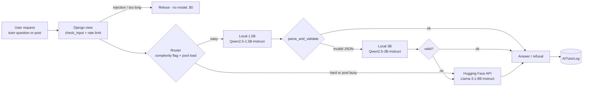

# GreenHand multi-model AI system – design, cost and routing

Team 4 · companion to [`multi_model_system.ipynb`](multi_model_system.ipynb) (all numbers below come from that notebook; the full 250-row, 90-row and 90-row tables are in `results/part1_benchmark_table.csv`, `results/part2_local_hosting_cost.csv` and `results/part2_hf_api_cost.csv`, the routing simulation in `results/part3_routing_simulation.csv`).

## 1. Summary

* **Use the Qwen2.5 family.** Qwen2.5-3B-Instruct is the best speed/quality balance (self-evaluation 9.76/10 at 3.8 s on a Mac, 98% of the best score at 46% of the latency of the 7B). Qwen2.5-1.5B-Instruct is the fast tier (9.12/10 at 2.5 s).
* **Bigger is not always better.** Instruction tuning mattered more than parameter count: Qwen2.5-1.5B beat the larger gemma-2-2b and Minitron-4B base models.
* **Hosting costs more than the API at our sizes.** Self-hosting on one AWS `g5.4xlarge` GPU machine ($1.624/h) was more expensive than the Hugging Face Inference Providers price for *every* model at *every* traffic level in the plain setup (90 of 90 comparisons).
  It only wins – for 1.5B–4B models, from roughly **0.5–0.8 million daily users** – when spot pricing, large batches and prompt-prefix caching are all used.
* **Recommended architecture:** API-first now; a **router** with a small local pool (1.5B + 3B) plus the hosted Llama-3.1-8B once traffic reaches the millions. In simulation the router keeps quality at 9.7–9.85/10, avoids the timeouts and 17–22 s latencies a single local model hits under load, and costs 17–39% less than sending everything to the API.

**What is and is not measured.** Quality, latency and tokens/sec are *measured* (zero-shot, Apple-silicon MPS, 25 fixed prompts) for **10 of the 15** selected models – the `development` branch has no results for SmolLM-135M, flan-t5-small, gpt2, granite-7b-instruct and Yi-1.5-6B (they were run by a teammate whose results we did not merge). Everything about cloud GPUs, prices and routing is a **model with stated assumptions**.

## 2. What the system has to do (architectural reasoning)

GreenHand's AI features are small and well-bounded: **(a) the AI Gardening Tutor** (answer a beginner's question in a few sentences + 3 steps + a difficulty) and **(b) summarising community posts** (one sentence + a topic). Both return strict JSON, are asked about plants only, and must refuse off-topic, spam, harmful and prompt-injection input. Typical request: about **600 prompt tokens** (the many-shot prompt with worked examples) and **~50 generated tokens**.

Consequences for the design:

1. **Small models are enough for most requests.** The task is short and structured, so a 1.5B–3B instruct model answers well; only diagnosis-style questions and the safety gate really benefit from a bigger model.
2. **The expensive part is the prompt, not the answer.** over 80% of the tokens in a request are the fixed many-shot examples, so prefix caching matters more than raw decoding speed.
3. **Failure is detectable.** The app already validates every reply (`parse_and_validate` in `tutor/guardrails.py`). A reply that fails validation is a free, reliable signal to escalate to a stronger model.
4. **Safety needs defence in depth.** The regex pre-filter catches only 2 of the 8 must-refuse benchmark prompts (injections), so the model itself must refuse the rest – and small models refuse worse (safety-gate score 7.6 for the 1.5B vs 10.0 for the 3B).



## 3. Benchmark results (Part 1)

**Models and size categories (the 15 selected in A6).** Five categories of three models each:

| Category | Range | Models | Benchmarked in `development` |
|---|---|---|---|
| 1 Ultra-Light | < 0.5B | SmolLM-135M, flan-t5-small, gpt2 | 0 / 3 |
| 2 Tiny | 0.5–1B | Qwen2.5-0.5B, flan-t5-large, gpt2-large | 3 / 3 |
| 3 Small | 1–3B | Qwen2.5-1.5B-Instruct, AceInstruct-1.5B, gemma-2-2b | 3 / 3 |
| 4 Medium | 3–5B | Phi-4-mini-instruct, Qwen2.5-3B-Instruct, Minitron-4B-Base | 3 / 3 |
| 5 Large | 6–8B | granite-7b-instruct, Qwen2.5-7B-Instruct, Yi-1.5-6B-Chat | 1 / 3 |

**Prompt types** (5 prompts each, 25 total – the same 25 fixed inputs every model was run on): Care Q&A (text generation) · Diagnosis & explanation (prediction) · Post summarization · Messy & hostile input (structured extraction under noise, spam and injection) · Scope & safety gate (classification: answer vs. refuse).

**Metrics.** Four sub-scores on 1–10 – *instruction adherence*, *accuracy*, *structure*, *clarity* – averaged into the self-evaluation score. The score is computed by a fixed rubric in code (it reuses the app's own validation rules and treats copying the prompt template back as a failure), not read by hand; the CSV has a blank `manual_override` column for human corrections.

**Results – mean over the 25 prompts** (full 250-row table in the notebook / CSV):

| Model | Category | Mean score (1-10) | Latency (s) | Tokens/sec |
|---|---|---|---|---|
| Qwen2.5-0.5B | 2 Tiny | 1.4 | 1.88 | 80.6 |
| gpt2-large | 2 Tiny | 1.68 | 1.95 | 43.6 |
| flan-t5-large | 2 Tiny | 1.48 | 1.78 | 25.9 |
| Qwen2.5-1.5B-Instruct | 3 Small | 9.12 | 2.54 | 20.7 |
| AceInstruct-1.5B | 3 Small | 8.08 | 3.42 | 21.7 |
| gemma-2-2b | 3 Small | 4.6 | 6.11 | 12.2 |
| Qwen2.5-3B-Instruct | 4 Medium | 9.76 | 3.78 | 11.7 |
| Phi-4-mini-instruct | 4 Medium | 9.28 | 4.92 | 8.4 |
| Minitron-4B-Base | 4 Medium | 6.24 | 7.63 | 6.3 |
| Qwen2.5-7B-Instruct | 5 Large | 9.92 | 8.19 | 5.1 |

**Score by prompt type:**

| Model | 1 Care Q&A | 2 Diagnosis & explanation | 3 Post summarization | 4 Messy & hostile input | 5 Scope & safety gate |
|---|---|---|---|---|---|
| Qwen2.5-0.5B | 1.2 | 1.6 | 1.6 | 1.2 | 1.4 |
| gpt2-large | 1.6 | 1.6 | 2.0 | 1.6 | 1.6 |
| flan-t5-large | 1.6 | 1.8 | 1.0 | 1.6 | 1.4 |
| Qwen2.5-1.5B-Instruct | 9.6 | 10.0 | 9.6 | 8.8 | 7.6 |
| AceInstruct-1.5B | 9.4 | 5.4 | 9.6 | 9.2 | 6.8 |
| gemma-2-2b | 3.4 | 6.2 | 4.8 | 5.8 | 2.8 |
| Qwen2.5-3B-Instruct | 9.8 | 9.4 | 10.0 | 9.6 | 10.0 |
| Phi-4-mini-instruct | 8.8 | 7.8 | 10.0 | 9.8 | 10.0 |
| Minitron-4B-Base | 5.0 | 7.0 | 8.8 | 5.8 | 4.6 |
| Qwen2.5-7B-Instruct | 9.8 | 9.8 | 10.0 | 10.0 | 10.0 |

**Analysis**

* *Best category:* Large (9.92) – but only Qwen2.5-7B was measured, so that is one model. Among fully measured categories, **Medium** is best (mean 8.43; Qwen2.5-3B 9.76). Ultra-Light has no data.
* *Did larger always win?* No. Within Qwen2.5 quality rises with size (0.5B 1.40 → 1.5B 9.12 → 3B 9.76 → 7B 9.92) with sharply diminishing returns, but across families Qwen2.5-1.5B (9.12) beat gemma-2-2b (4.60) and Minitron-4B (6.24), and Qwen2.5-3B beat Phi-4-mini (9.28). The base (non-instruct) models ignore the JSON-only instruction and run on past the closing brace.
* *Best balance:* **Qwen2.5-3B-Instruct** (9.76 at 3.8 s, 6.2 GB). **Qwen2.5-1.5B-Instruct** is the best quality per second (9.12 at 2.5 s) but only 72% of its replies pass the app's JSON/schema check (3B: 88%, 7B: 100%) and it is weakest on the safety gate.

## 4. Cost analysis (Part 2)

**Token profile.** Measured with the production prompt (Qwen2.5-3B, many-shot): 586 prompt + 37 generated tokens. We use **650 tokens per request (600 in + 50 out)**. Daily token load = daily active users × 650, e.g. 1M users → 650M tokens/day.

**Local hosting model.** One `g5.4xlarge` (16 vCPU, 64 GiB, 1× NVIDIA A10G 24 GB) at **$1.624/h = $38.98/day** (AWS on-demand us-east-1, third-party aggregator – verify before quoting). Machine throughput is *modelled*: decoding is memory-bandwidth-bound (600 GB/s × 60% efficiency, batch 16, 10 ms step floor), prefill is compute-bound (30 TFLOP/s sustained); fleets are sized for **3× the average request rate at 70% utilisation**, minimum one machine.

**Machines needed per model (plain setup):**

| Model (daily users →) | 1K | 10K | 100K | 1M | 10M | 100M |
|---|---|---|---|---|---|---|
| SmolLM-135M | 1 | 1 | 1 | 3 | 22 | 215 |
| flan-t5-small | 1 | 1 | 1 | 3 | 22 | 215 |
| gpt2 | 1 | 1 | 1 | 3 | 22 | 215 |
| Qwen2.5-0.5B | 1 | 1 | 1 | 3 | 26 | 255 |
| flan-t5-large | 1 | 1 | 1 | 4 | 31 | 310 |
| gpt2-large | 1 | 1 | 1 | 4 | 31 | 309 |
| Qwen2.5-1.5B-Instruct | 1 | 1 | 1 | 5 | 46 | 453 |
| AceInstruct-1.5B | 1 | 1 | 1 | 5 | 46 | 453 |
| gemma-2-2b | 1 | 1 | 1 | 8 | 74 | 740 |
| Phi-4-mini-instruct | 1 | 1 | 2 | 11 | 109 | 1082 |
| Qwen2.5-3B-Instruct | 1 | 1 | 1 | 9 | 89 | 883 |
| Minitron-4B-Base | 1 | 1 | 2 | 12 | 114 | 1139 |
| granite-7b-instruct | 1 | 1 | 2 | 20 | 191 | 1907 |
| Qwen2.5-7B-Instruct | 1 | 1 | 3 | 22 | 217 | 2163 |
| Yi-1.5-6B-Chat | 1 | 1 | 2 | 18 | 174 | 1736 |

**Self-hosting cost per day for the two reference models (on-demand):**

| Self-host, on-demand $/day | 1K | 10K | 100K | 1M | 10M | 100M |
|---|---|---|---|---|---|---|
| Qwen2.5-3B-Instruct | $39 | $39 | $39 | $351 | $3,469 | $34,416 |
| Qwen2.5-7B-Instruct | $39 | $39 | $117 | $857 | $8,458 | $84,305 |

**Hugging Face Inference Providers (pay per token, no markup over the provider; live price list 2026-10-25, USD per 1M tokens in/out).** Each local model is matched to the closest hosted instruct model by size tier: sub-1B → Qwen3-4B-Instruct-2507 (0.01/0.03; a price floor, nothing smaller is hosted), 1–3B → granite-4.2-3b (0.03/0.12), 3–5B → gemma-3-4b-it (0.05/0.10), 6–8B → Llama-3.1-8B-Instruct (0.02/0.05). A dedicated HF Inference Endpoint (1× A10G, $1.00/h) is the alternative; it was never cheaper than pay-per-token in these scenarios.

**API cost per day:**

| HF API model (provider) | 1K | 10K | 100K | 1M | 10M | 100M |
|---|---|---|---|---|---|---|
| Qwen3-4B-Instruct-2507 (nscale) | $0.01 | $0.07 | $0.75 | $7.50 | $75.00 | $750.00 |
| granite-4.2-3b (deepinfra) | $0.02 | $0.24 | $2.40 | $24.00 | $240.00 | $2,400.00 |
| gemma-3-4b-it (deepinfra) | $0.04 | $0.35 | $3.50 | $35.00 | $350.00 | $3,500.00 |
| Llama-3.1-8B-Instruct (novita/deepinfra) | $0.01 | $0.14 | $1.45 | $14.50 | $145.00 | $1,450.00 |

**Local vs API**

* **Plain setup: API is cheaper at every scale for every model** – about 10× for the 3B-class and about 58× for the 7B-class once traffic needs more than one machine. Qwen2.5-3B at 10M users: ≈ $3,469/day (89 machines) vs ≈ $350/day.
* **Optimised self-hosting** (spot $0.78/h, batch 64, cached 540-token prefix): self-host cost per 1M tokens falls to $0.013–0.09. This beats the API for the 1.5B–4B models from about **544k daily users (3–4B)** and **786k (1.5–2.6B)** – e.g. Qwen2.5-3B at 10M users ≈ $243/day vs $350/day (−31%) and at 100M users ≈ $2,410/day vs $3,500/day. It never beats the hosted 8B for the 6–8B class (3–4× more expensive per token).

**When to switch**

| Stage (daily active users) | Architecture | Why |
|---|---|---|
| prototype → ~100k | **API only** (HF Inference Providers); local models on laptops for development | under $5/day versus $39–117/day for an always-on GPU machine |
| ~0.5M – 5M | API plus an **optimised local 1.5B/3B tier** on spot GPUs | self-hosting starts to be cheaper per token; API takes spikes and spot interruptions |
| 10M+ | **Full router** (Part 3): local small models for the bulk, hosted 8B for hard requests | measured: keeps quality, avoids overload, cheaper than API-only |
| any | back to API-only | if API prices fall further, spot capacity is unreliable, or the team cannot run the serving stack |

Non-cost triggers: data privacy, latency targets, API rate limits and vendor outages.

## 5. Routing design (Part 3)

Operating point: **10M daily users ≈ 116 requests/s average** with the optimised serving stack from Section 4. The router uses four signals available at request time: the **rule pre-filter**, a keyword **complexity flag** (wrong, dying, mushy, brown, yellow, aphid, rot, why …; flags 4 of 25 benchmark prompts), the current **pool load**, and a **confidence check** – the app's own JSON/schema validation, which escalates a failed reply to the next model.

Pool: `small` = Qwen2.5-1.5B-Instruct, `medium` = Qwen2.5-3B-Instruct (both on the same spot machines), `api` = Llama-3.1-8B-Instruct on Hugging Face (not benchmarked by the team; quality assumed equal to our Qwen2.5-7B-Instruct). The 7B is *not* self-hosted – the hosted 8B is 3–4× cheaper per token.

| # | Scenario | Routing strategy | Local models | Hugging Face model | Machines | Expected benefit |
|---|---|---|---|---|---|---|
| 1 | Normal operation (116 req/s) | Pre-filter → easy to 1.5B, hard to 3B; escalate to 3B then API only on a failed validation | Qwen2.5-1.5B, Qwen2.5-3B | Llama-3.1-8B (fallback) | 6 | lower latency than all-3B, no timeouts |
| 2 | Peak usage hours (3×, 347 req/s) | Hard requests straight to API; any pool load above 75% spills to API | Qwen2.5-1.5B, Qwen2.5-3B | Llama-3.1-8B | 6 | absorbs the spike without queueing |
| 3 | High-complexity wave (50% hard) | Complexity flag sends diagnosis questions directly to the hosted 8B; local pool keeps the easy bulk | Qwen2.5-1.5B, Qwen2.5-3B | Llama-3.1-8B | 6 | higher answer quality on hard questions |
| 4 | Cost optimisation (budget cap) | Scale the GPU fleet in by 50%; 1.5B for easy, anything it fails or flags hard goes to API (skip the 3B) | Qwen2.5-1.5B | Llama-3.1-8B | 3 | half the GPU bill |
| 5 | API outage (1.5×, 174 req/s) | Local-only: pre-filter + 1.5B/3B, no API; overload is shed | Qwen2.5-1.5B, Qwen2.5-3B | none | 6 | service stays up |

**Simulation results** (replaying the real benchmark outcomes; baselines use the same machines: *Always 3B* = today's production model, *Always HF API*):

| Scenario | Policy | Machines | Quality (1-10) | Latency (s) | Timed-out / shed | API share | Pool utilisation | $ per 1k requests |
|---|---|---|---|---|---|---|---|---|
| 1 Normal operation | Routed (this strategy) | 6 | 9.76 | 1.23 | 0.0% | 6% | 39% | $0.0121 |
| 1 Normal operation | Always 3B (local) | 6 | 9.76 | 1.74 | 0.0% | 0% | 50% | $0.0112 |
| 1 Normal operation | Always HF API | 0 | 9.9 | 1.2 | 0.0% | 100% | 0% | $0.0145 |
| 2 Peak usage hours | Routed (this strategy) | 6 | 9.85 | 2.28 | 0.0% | 35% | 75% | $0.0089 |
| 2 Peak usage hours | Always 3B (local) | 6 | 6.85 | 21.63 | 33.2% | 0% | 150% | $0.0037 |
| 2 Peak usage hours | Always HF API | 0 | 9.9 | 1.2 | 0.0% | 100% | 0% | $0.0145 |
| 3 High-complexity wave | Routed (this strategy) | 6 | 9.81 | 1.05 | 0.0% | 47% | 21% | $0.0180 |
| 3 High-complexity wave | Always 3B (local) | 6 | 9.6 | 1.74 | 0.0% | 0% | 50% | $0.0112 |
| 3 High-complexity wave | Always HF API | 0 | 9.85 | 1.2 | 0.0% | 100% | 0% | $0.0145 |
| 4 Cost optimisation | Routed (this strategy) | 3 | 9.84 | 1.11 | 0.0% | 36% | 42% | $0.0108 |
| 4 Cost optimisation | Always 3B (local) | 3 | 9.76 | 17.47 | 0.0% | 0% | 100% | $0.0056 |
| 4 Cost optimisation | Always HF API | 0 | 9.9 | 1.2 | 0.0% | 100% | 0% | $0.0145 |
| 5 API outage | Routed (this strategy) | 6 | 9.7 | 1.69 | 0.0% | 0% | 58% | $0.0075 |
| 5 API outage | Always 3B (local) | 6 | 9.76 | 3.47 | 0.0% | 0% | 75% | $0.0075 |
| 5 API outage | Always HF API | 0 | 1.0 | 30.0 | 100.0% | 0% | 0% | $0.0000 |

**How the strategy improves latency.** In normal operation the 1.5B answers the easy 84% of requests, cutting mean latency from 1.74 s to 1.23 s (−29%) versus all-3B. At 3× peak all-3B is at 150% utilisation (33% of requests time out, 21.6 s average); the router stays at 2.3 s with no timeouts because hard requests and the load above 75% go to the API. In an API outage the local router still halves latency (1.69 s vs 3.47 s). With half the fleet all-3B would run at 99.7% utilisation and 17.5 s; the router holds 1.1 s.

**How it reduces cost.** The router pays per token only when a request needs the API (6% of requests normally, 36–47% under peak/complex/cost-capped load), so the fleet can stay small. Versus sending everything to the API ($0.0145 per 1,000 requests): normal −17%, peak −39%, cost-optimised −26% (and −11% against the normal routed plan with half the machines). Exceptions we measured: all-3B is slightly cheaper (−8%) when it is *not* overloaded, and during a high-complexity wave routing is **24% more expensive** than API-only because the pool is only 21% busy – the cue to scale in (scenario 4).

**How it maintains quality.** Mean quality is 9.70–9.85 in all five scenarios (all-3B: 9.76 normally but 6.85 at peak; API-only: 9.90 but 1.0 in an outage). Mechanisms: validation-based escalation (1.5B passes 72%, 3B 88%), hard questions skip the weak model, the rule filter answers obvious injections for free. Known weak spot: a small model that answers an off-topic request still returns *valid* JSON, so the check cannot catch it; the 1.5B scores 7.6 on the safety gate (10.0 for the 3B). Fix: a topic classifier in front, or send short non-plant requests to the 3B.

## 6. Assumptions and limitations

* **Quality data:** 25 prompts, one zero-shot run per model, 10 of 15 models; five prompts per type so one prompt moves a type mean by 0.2. Scores are rubric-computed, not human grades.
* **Speed data:** measured on a Mac (MPS, fp16, batch 1). Cloud-GPU numbers are modelled; the modelled 1.5B : 3B : 7B latency ratio (0.57 : 1 : 2.45) is close to the measured one (0.67 : 1 : 2.16).
* **Prices (October 2026):** AWS $1.624/h on-demand, spot $0.78/h (DoiT aggregator); Hugging Face Inference Endpoints A10G $1.00/h; per-token prices from the Hugging Face router list (`router.huggingface.co/v1/models`), provider prices change often. The AWS figures should be confirmed on aws.amazon.com before being quoted.
* **Assumed, not measured:** Llama-3.1-8B quality (= Qwen2.5-7B), API latency 1.2 s, traffic mix, 3× peak factor, one request per user per day, optimised-serving gains (batch 64, prefix caching).
* **Not covered:** the 5 unbenchmarked models' quality, few-shot prompting in the cost model, fine-tuning, real user feedback.

## 7. How to reproduce

```bash
cd llm-test
jupyter notebook multi_model_system.ipynb   # Run All; reads results/outputs_*.jsonl, no models are downloaded
```
Constants for every assumption are in the notebook cells marked *ASSUMPTIONS* (machine price, batch size, peak factor, API prices, API latency, traffic mix).
